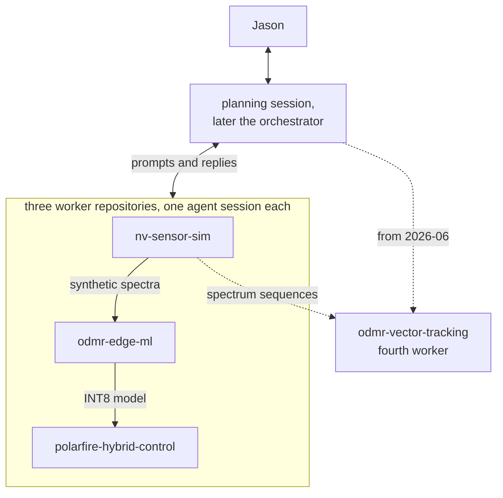

# Tychon quantum sensing: an agent-orchestrated NV-magnetometer build

[](https://github.com/jasonphillip/tychon-quantum-sensing/actions/workflows/bench.yml) [](https://github.com/jasonphillip/tychon-quantum-sensing/actions/workflows/tests.yml) [](https://doi.org/10.5281/zenodo.23323384)

Software toward AI-assisted control of an NV-diamond magnetometer, developed and tested without a sensor. Nitrogen-vacancy (NV) centres in diamond reveal the magnetic field in their optically detected magnetic resonance (ODMR) spectrum. The repository holds a simulator for synthetic ODMR spectra, small neural networks that estimate the field, and a PID (proportional-integral-derivative) controller with a neural-network correction on a PolarFire SoC kit, which pairs an FPGA (field-programmable gate array) with a processor. Coding agents wrote most of the code from my specifications; I planned, relayed and reviewed the work.

**Demonstrated state.** The controller ran on PolarFire SoC silicon with replayed synthetic spectra as input; no diamond sensor was connected. Model accuracy figures come from synthetic data. The parts are not one integrated or deployed system.

**What is shown, and what is not**

- Measured on silicon: watchdog trip time median 2.000 ms over 120 trips; an 8-hour soak at 3,319 Hz; fallback to plain PID within one update after a timeout (60 of 60, 20 of 20, 10 of 10) — [FPGA worker](workers/polarfire-hybrid-control/README.md), [engineering decision 2](docs/engineering-decisions.md#2-test-actual-fallback-rather-than-count-watchdog-trips).
- Measured on silicon: the deployed INT8 model's output on the kit equals its INT8 TFLite output bit for bit on 512 held-out synthetic spectra; final-field error 14.47 µT against 15.21 µT for PID alone; 0.038 ms per sample on the NPU; the dataset recipe is committed and reproduces the data byte for byte — [deployed model on the kit](workers/odmr-edge-ml/docs/deployed_model_on_kit_2026-10.md). That model is a bounded correction to PID, not a field estimator: a training-mean constant predictor scores 12.3 µT on the same test split, and no correction within the ±2.25 µT clamp can beat it — [constant baselines](workers/odmr-edge-ml/docs/scalar_constant_baselines_2026-10.md).
- Synthetic only: `make bench` 10.53 µT against 12.26 µT for a constant baseline ([benchmark](bench/README.md)); with a known 1 mT bias, vector models reach 75.5 µT RMS against 115.2 µT for assuming the bias ([bias-field results](workers/odmr-edge-ml/docs/vector_v1_bias_field.md)); on the field-cone set, which includes beyond-envelope probes, the learned tracker ends 108 of 120 sequences without a lock in every tested arm ([three-seed ablation](workers/odmr-vector-tracking/docs/association_loss_multiseed.md)).
- Compared with measured data: the simulator's line widths were fitted to four public ODMR datasets, in-sample ([validation](workers/nv-sensor-sim/docs/external_validation_results.md), [fit](workers/nv-sensor-sim/docs/simulator_fit_results.md)).
- Not shown: a live diamond; a sensitivity figure (nT/√Hz); any estimator evaluated on measured spectra; a comparison against a classical fit with exact Hamiltonian inversion (a pre-registered study is pending; see the [reviewer path](docs/start-here-reviewers.md)).

I built this independently around an SBIR (Small Business Innovation Research) Phase I proposal that was not selected. It received no government funding.

## Three workstreams, one coordinator

The core work ran in three separate worker repositories, each with its own coding-agent session (Claude Code or Codex), coordinated by a planning session and me: a claude.ai project, then from May 2026 an orchestrator session. Until July 2026 I pasted every prompt and reply between sessions by hand. After that, tasks travelled as files, sent with a [dispatch tool](orchestrator/tvw/scripts/dispatch.sh) from 2026-07-10, and I told each worker when one was waiting. A fourth worker started on 2026-06-29. The histories were later merged into this repository.



| Workstream | Takes in | Produces |
|---|---|---|
| [Physics simulation and synthetic datasets](workers/nv-sensor-sim/) | Field, noise and sampling settings | Labelled spectra in train, validation and test splits, with a manifest |
| [Model training, evaluation and export](workers/odmr-edge-ml/) | The simulator's datasets | Trained networks and an INT8 (8-bit integer) model |
| [FPGA control, firmware and hardware checks](workers/polarfire-hybrid-control/) | The INT8 model, replayed synthetic spectra | FPGA design, kit software, silicon measurements |
| [Field-vector tracking](workers/odmr-vector-tracking/), the fourth worker | Spectrum sequences | A field-direction tracker, FP32 simulation only |

One coordination round: [an external review turned into per-repository prompts](planning/excerpts/03-external-review-to-repo-prompts.md) (April 2026). The planning chat wrote the prompts, reviewed a worker's reply, found that a documented test-set safeguard was never implemented, and wrote the fix prompt. The fix is simulator commit [9529f61](https://github.com/jasonphillip/tychon-quantum-sensing/commit/9529f61).

## Where to go

| To | Open |
|---|---|
| Understand the project in five minutes | [Case study](docs/case-study.md) |
| Review the evidence in twenty minutes | [Reviewer path](docs/start-here-reviewers.md) |
| Navigate as a visiting agent | [Repository map](AGENTS.md), [llms.txt](llms.txt) |
| Generate synthetic spectra | [Synthetic-data walkthrough](docs/synthetic-data.md) |
| Inspect FPGA measurements | [FPGA worker: status and evidence](workers/polarfire-hybrid-control/README.md#where-this-fits) |
| Read the claims I would challenge first | [Weakest claims](orchestrator/INVENTORY.md#6-weakest-claims--what-would-not-survive-a-sharp-reviewer) |
| See decisions and who made them | [Engineering decisions](docs/engineering-decisions.md), [conversation excerpts](planning/excerpts/) |
| Take your own model to the V250 | [From a TFLite file to inference on the kit](docs/model-to-v250.md) |
| Learn the physics and terms | [Primer](docs/primer.md), [glossary](docs/glossary.md) |

## Representative results

| Result | Kind | Limit | Evidence |
|---|---|---|---|
| Watchdog trip time median 2.000 ms over 120 trips; 8-hour soak at 3,319 Hz; fallback to plain PID within one update after a timeout | Hardware measurement | Replayed input, no diamond; paced by software on the SoC processor, not in the fabric; a frozen processor gets no fallback until it resumes | [FPGA worker](workers/polarfire-hybrid-control/README.md) |
| `make bench`: 10.53 µT mean field error on 200 test spectra, against 12.26 µT for a constant baseline | Synthetic evaluation | FP32 on a CPU; the INT8 model on the kit is not in this number | [Benchmark](bench/README.md) |
| Deployed INT8 model on the kit: 512 held-out spectra, kit output = INT8 TFLite output bit for bit; final-field error 14.47 µT against 14.47 float and 15.21 PID alone; 0.038 ms per sample | Hardware measurement on synthetic input | Replayed synthetic spectra; the model corrects at most ±2.25 µT per step, so the error stays near PID's, and a training-mean constant predictor (12.3 µT on the full split) beats it on total-field error; dataset recipe committed and reproduced | [Deployed model on the kit](workers/odmr-edge-ml/docs/deployed_model_on_kit_2026-10.md), [constant baselines](workers/odmr-edge-ml/docs/scalar_constant_baselines_2026-10.md) |
| Classical two-Lorentzian fit vs the networks, scalar task: bench cohort fit 21.45 µT, MLP 10.53, PID proxy 25.93, training mean 12.26; production cohort fit 22.86, deployed INT8 FCNN 22.38, PID 23.54, training mean 12.33 | Synthetic evaluation | The two-line fit measures an axial projection, not the magnitude; the two cohorts use different frequency grids, so each model is scored only on its own | [Scalar fit vs network](workers/odmr-edge-ml/docs/scalar_fit_vs_network_2026-10.md) |
| Default simulated lines are 2 to 11 times narrower than in four public ODMR datasets; a per-spectrum fit matches the widths | Comparison with measured data | The fit is in-sample | [Validation](workers/nv-sensor-sim/docs/external_validation_results.md), [fit](workers/nv-sensor-sim/docs/simulator_fit_results.md) |
| Three local critics cut false acceptances from 27 to 10 on a 60-claim test set | Software experiment | Abstained on 58 % of claims; 62.5 % of the claims it accepted were unsupported | [How claims were checked](orchestrator/README.md) |

Every result with its limits, and the timeline: [case study](docs/case-study.md#results-and-limits).

## Try it

Generate four synthetic spectra in about a second (repository root, Python 3.11 or later):

```bash
python -m pip install -e workers/nv-sensor-sim
python -m nv_sensor_sim.pipelines.batch_generate \
  --config workers/nv-sensor-sim/configs/quickstart_tiny.yaml --output-dir /tmp/nv-sim-tiny
```

It writes `dataset.h5` and `manifest.json`. [`make bench`](bench/README.md) reproduces the benchmark above. `demo/fpga-demo-dashboard/run_demo.sh` serves the [demo dashboard](demo/fpga-demo-dashboard/) at http://localhost:8077 without hardware.


*Dry-run recording: every value, including the PASS and LIVE badges, comes from the dashboard's software model of the kit, not from hardware.*

## License, citation and history

Apache-2.0, except output from Microchip Libero SoC and Synopsys Synplify Pro and 17 constraint files from Microchip's Icicle Kit reference design; [NOTICE](NOTICE) names them. Cite with [CITATION.cff](CITATION.cff) or the DOI above.

Each folder except `planning/` and `docs/` was its own repository, merged with original authors and dates; [COMMIT-MAP.tsv](COMMIT-MAP.tsv) maps older commit IDs. First attempts: [archive/v0](archive/v0); failed FPGA bring-ups: `polarfire/bringup/*` branches. "Phase I", "KPP" (key performance parameter) and "deliverable" in files refer to the proposal's plan. History: [timeline](docs/case-study.md#timeline), [workflow retrospective](docs/workflow-retrospective.md).
