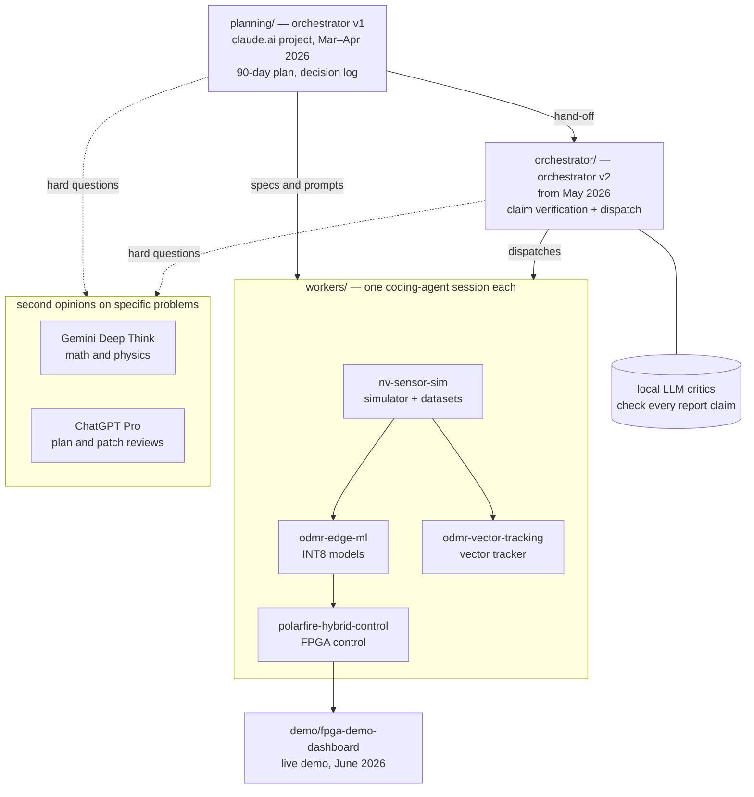

# Tychon quantum sensing: an agent-orchestrated NV-magnetometer build

[](https://github.com/jasonphillip/tychon-quantum-sensing/actions/workflows/bench.yml) [](https://github.com/jasonphillip/tychon-quantum-sensing/actions/workflows/tests.yml) [](https://doi.org/10.5281/zenodo.23323384)

I proposed this work to an AFWERX SBIR Phase I topic on 5 August 2025. The government shutdown that autumn stalled the program, and the decision slipped into 2026. Rather than wait for funding to hire the people on the proposal, I built it myself. The commit history starts in March 2026. The proposal was not selected on 12 May 2026, and I kept building. There was never a contract or government funding. Files that say Phase I, KPP or deliverable follow the plan and report I wrote for it.

## Who I am

**Jason Phillip.** I'm an applied AI engineer and the founder of Tychon AI.

Since 2024 I've taken three space programs from physics simulation to a small model running on the chip it was built for. The first was a star tracker, then a spectrum monitor, and most recently the controls for a quantum sensor. LLMs wrote the code on the first one, and by the last they were running the FPGA tools too. My job is to direct the work and catch where it fails, and every claim has to trace to a file, a commit or a log.

[tychonai.com](https://tychonai.com/) · [LinkedIn](https://www.linkedin.com/in/jasonphillip/) · [X](https://x.com/jasonphillip)

I used coding agents to build the software for NV-diamond quantum magnetometers. One orchestrator session handed out the tasks, and each worker repository had its own agent session. The orchestration was human-mediated: until the dispatch tool existed in July 2026, I carried the prompts between the planning chat and the repository sessions by hand. Together they produced a physics simulator, edge ML models, PID plus neural-network control on a PolarFire SoC FPGA, a field-vector tracker and a live demo dashboard, which make up a sensor-to-actuator loop at the small end of physical AI. I planned the work, wrote the specs and reviewed what came back. The agents wrote most of the code.

When two local LLM critics checked my technical report, they agreed 10 times out of 10 on the first pass, and I counted that as a failed independence test. A May 2026 paper found the same problem in a bigger panel, where nine frontier LLM judges gave about two independent votes ([arXiv 2605.29800](https://arxiv.org/abs/2605.29800)). This script reports agreement, chance-corrected agreement and the effective number of independent votes for any verdict CSV. With a reference answer key (`--truth`) it also correlates the critics' errors, as the paper does. Without one it only measures how often they agree. It runs in under a second and doesn't need a model or a GPU.

```bash
python3 orchestrator/tvw/scripts/critic_independence.py orchestrator/tvw/audits/stage-4.7-verdicts.csv
```

That file holds a 114-claim pass, and 93 of the claims have a verdict from both critics. On those, the script reports 90 % raw agreement but a chance-corrected agreement (Fleiss' kappa) of -0.04, because one critic marks 91 % of the claims SUPPORTED and the other 99 %.

The software is licensed under Apache-2.0. That license does not cover output from Microchip Libero SoC and Synopsys Synplify Pro, or 17 constraint files copied from Microchip's Icicle Kit reference design. [NOTICE](NOTICE) names the files.

The build started from a 90-day plan in March 2026 and continued through September 2026.

GitHub Actions runs the tests on CPU runners for every push, and in the 2026-10-10 run 764 passed across the simulator, edge ML, tracker, FPGA tooling, dashboard and orchestrator. Another 63 were skipped because they need datasets that aren't in the repository, optional packages, a private package or the FPGA kit.

## Results at a glance

| Result | Limit |
|---|---|
| On PolarFire SoC silicon, the watchdog trip time was a median 2.000 ms over 120 trips on 2026-07-01, an 8-hour soak ran 95.7 M steps at 3,319 Hz on 2026-07-02, and after a timeout control passed to plain PID within one update on 2026-10-09 | Paced by software on the SoC's processor, replayed ODMR input, no live diamond |
| `make bench` on a CPU runner gives 10.53 µT mean field error on 200 synthetic test spectra, against 12.26 µT for a constant baseline and 25.93 µT for a PID proxy | Synthetic data, FP32. The INT8 model on the kit isn't in this number |
| Two local critics agreed 10 of 10 on the first pass, which I counted as a failed independence test. With a third, stronger critic and all three required to agree, false acceptances fell from 27 to 10 on a 60-claim test set. After a design review I retracted my tracker baseline numbers | The three-critic setup abstained on 58 % of claims |

<details>
<summary>All results, with limits</summary>

| Part | Result | Limit |
|---|---|---|
| FPGA watchdog | Trip time measured on PolarFire SoC silicon on 2026-07-01: median 2.000 ms over 120 trips | One dev kit |
| FPGA control loop | 8-hour soak on silicon on 2026-07-02: 95.7 M steps at 3,319 Hz, and the loop never stopped advancing. Five short scheduling delays over 2 ms each tripped the watchdog | Paced by software on the SoC's processor, not in the fabric; replayed ODMR input, no live diamond. A counted trip does not show that the controller fell back (next row) |
| Watchdog fallback | Board tests on 2026-10-09. When the next controller update saw the timeout, control passed to plain PID within one update (66 to 71 µs), with no jump in the actuator value, 60 of 60. After a software fix that starts the hand-over whenever the timeout is high, the two cases that had failed now fall back as well: a timeout that cleared before the next update, 20 of 20 (was 0 of 20), and a 1 s pause of the control process, 10 of 10 after it resumes (was 0 of 10) | A processor that stays frozen gets no fallback until it resumes. At recovery the actuator still steps by about 0.01, ten times the slew limit |
| Edge ML benchmark | `make bench` trains a 10,689-parameter network on synthetic spectra. Mean field error on 200 test spectra is 10.53 µT, against 12.26 µT for a constant baseline and 25.93 µT for a derivative zero-crossing PID proxy | Synthetic data, FP32 on a CPU; INT8 accuracy on the kit is not in this table |
| Vector models | With a known 1 mT bias field, eight small networks estimate the ambient field (up to 200 µT) with 75.5 µT RMS error from label-free anchors. Assuming the bias alone gives 115.2 µT | Simulated spectra. Earlier GPU-trained versions were invalid, because the bfloat16 training path saved models that didn't reproduce their own validation error. I fixed that and retrained them |
| Vector tracker | Follows the field vector through spectral line crossings, reliable to about 30 to 40° off the bias axis. With the association losses taken out of training, field-cone error fell in all three seeds I ran. RMSE dropped by 0.46, 0.17 and 0.17 mT and mean angular error by 10.4, 3.7 and 8.6°, with every 95 % interval below zero. Identity switches on the dwell set went down in all three too | FP32 simulation only, with no INT8 export or on-target run. I've since turned the association losses off in the default training config. Apart from these three seeds, the tracker hasn't been retrained with that setting |
| Simulator | Against four public ODMR datasets, the default simulated lines are 2 to 11 times narrower than measured. When I fit line width and contrast per spectrum, the simulated widths match the measured ones, 2.3 to 7.3 MHz | The fit is in-sample, since the same rows were used to choose the values. With one shared setting the zero-field lines are still narrower than measured |
| Claim checks | Audits of my technical report on 2026-05-01, up to 114 claims per pass through two local critic models. A manual structure review found three critical errors, all fixed in the corrected report. On a 60-claim test set with 30 deliberately altered claims, I added a stronger local model (DeepSeek-V4-Flash on a second workstation) and required all three critics to agree. False acceptances fell from 27 to 10 | On the first run the two critics agreed 10 times out of 10, which I counted as a failed independence test. The three-critic setup abstained on 58 % of claims, 62.5 % of the claims it accepted weren't supported, and on a rerun of 10 claims the stronger model gave a different verdict on 2 |

</details>

Where I'd push back on these results myself: [the weakest claims](orchestrator/INVENTORY.md#6-weakest-claims--what-would-not-survive-a-sharp-reviewer), my own list. What review caught: [tracker baseline numbers I retracted](docs/case-study.md#what-the-reviews-caught) and [errors in agent output](orchestrator/README.md#checking-the-agents-as-well-as-the-report).

## The demo dashboard


*Measured on hardware [HW]: 120 clear-to-trip events on the dev kit on 2026-07-01, from `workers/polarfire-hybrid-control/libero/reports/2026-07-01-watchdog-trip/watchdog_trip_run1.log`. The dashboard below is the software model.*


*The board every [HW] number was measured on: a Microchip PolarFire SoC Icicle Kit (MPFS250T) in a vented enclosure, powered and on the bench network.*


This recording is the dashboard in dry-run mode. Every value in it, including the PASS and LIVE badges, comes from the dashboard's software model of the kit, not from hardware. In live mode the same screens read the kit over SSH. Source: [demo/fpga-demo-dashboard](demo/fpga-demo-dashboard/).

## How it fits together



The diagram shows how the parts connect, not one deployed system, so the table below gives the demonstrated state of each part.

| Part | Demonstrated state |
|---|---|
| Simulator and synthetic datasets | Implemented. Against four public ODMR datasets the default lines are 2 to 11 times narrower than measured. When I fit line width and contrast per spectrum, the widths match, in-sample only |
| Scalar ML and FPGA control | Trained and exported to INT8. The model and the control loop run on the PolarFire development kit with replayed ODMR input, paced by software on the SoC's processor. No live diamond sensor in the loop |
| Vector tracker | FP32 simulation only. Not connected to the FPGA loop, and no INT8 export |
| Claim checker | An experimental review aid. On a 60-claim test set the three-critic setup abstained on 58 % of claims, and 62.5 % of the claims it accepted weren't supported |

## Where to look first

| To | Open |
|---|---|
| Understand the project | [docs/case-study.md](docs/case-study.md), 5 minutes, then [the timeline](#timeline) |
| Inspect the evidence | [orchestrator/INVENTORY.md, section 6](orchestrator/INVENTORY.md#6-weakest-claims--what-would-not-survive-a-sharp-reviewer) for the claims I'd challenge first, and [workers/polarfire-hybrid-control/README.md](workers/polarfire-hybrid-control/README.md) for the hardware results |
| Inspect decisions and agent contributions | [Three engineering decisions](docs/engineering-decisions.md), then [selected conversation evidence](planning/excerpts/05-research-and-verification.md) |
| Run the benchmark | `make bench`. What it needs, the numbers to expect and its synthetic-data scope are in [bench/README.md](bench/README.md) |

<details>
<summary>Full index</summary>

| If you have | Open |
|---|---|
| 1 minute | this page and [the timeline](#timeline) |
| 5 minutes | [docs/case-study.md](docs/case-study.md): how the work was planned, reviewed and verified |
| the claims I'd challenge first | [orchestrator/INVENTORY.md, section 6](orchestrator/INVENTORY.md#6-weakest-claims--what-would-not-survive-a-sharp-reviewer): what would not survive a sharp reviewer |
| no physics background | [docs/primer.md](docs/primer.md): NV diamonds, ODMR, and why a network on an FPGA |
| the machines I used and what ran where | [docs/lab.md](docs/lab.md) |
| how I used manuals, notebooks and local checks | [docs/method.md](docs/method.md) |
| what I read | [docs/references.md](docs/references.md): manuals, papers and the public datasets |
| a term I don't know | [docs/glossary.md](docs/glossary.md) |
| how the workflow performed, from its own records | [docs/workflow-retrospective.md](docs/workflow-retrospective.md) |
| why the orchestrator exists and why its critics stay off the web | [orchestrator/README.md](orchestrator/README.md): it started as a check on my own work |
| the orchestration loop | [planning/excerpts/](planning/excerpts/): the planning chat writing prompts for each repo session and reviewing what came back |
| mistakes other models caught | [docs/second-opinions.md](docs/second-opinions.md) |
| a real dispatch | [orchestrator/tvw/audits/dispatch-9-increment8-bc-stack-2026-07-11.md](orchestrator/tvw/audits/dispatch-9-increment8-bc-stack-2026-07-11.md) and the tool that sends it, [dispatch.sh](orchestrator/tvw/scripts/dispatch.sh) |
| critic verdicts | [orchestrator/tvw/audits/stage-4.7-verdicts.csv](orchestrator/tvw/audits/stage-4.7-verdicts.csv) and [orchestrator/STAGES.md](orchestrator/STAGES.md) |
| hardware results | [workers/polarfire-hybrid-control/README.md](workers/polarfire-hybrid-control/README.md) |
| a terminal and 10 minutes | [demo/fpga-demo-dashboard/run_demo.sh](demo/fpga-demo-dashboard/run_demo.sh): the demo dashboard in DRY-RUN mode, its default, which drives a software model of the kit, so no board is needed. Needs Python 3 and Node.js with npm; the first run builds a virtual environment and the frontend, then serves http://localhost:8077 |
| the plan and its decisions | [planning/docs/90-day-execution-playbook-v4.md](planning/docs/90-day-execution-playbook-v4.md) and [planning/docs/decision-log.md](planning/docs/decision-log.md) |
| the agents' own instructions | [orchestrator/AGENTS.md](orchestrator/AGENTS.md) and `workers/*/AGENTS.md` |

</details>

## How the agents were used

| Role | Tool | Where it shows |
|---|---|---|
| Planner and first orchestrator | a claude.ai project | [planning/](planning/) |
| Grounded Q&A over vendor manuals | Google NotebookLM | [docs/method.md](docs/method.md) |
| Math and physics checks | Gemini Deep Think, on the problems it was strongest at | [docs/second-opinions.md](docs/second-opinions.md) |
| Second reviews of plans and patches | ChatGPT Pro | [docs/second-opinions.md](docs/second-opinions.md) |
| Orchestrator | a Claude Code session with its own rules | [orchestrator/](orchestrator/) |
| Workers | one Claude Code or Codex session per repository | [workers/](workers/) |
| Claim critics | qwen3-coder:30b and nemotron-mini, run locally with Ollama | [orchestrator/STAGES.md](orchestrator/STAGES.md) |

By rule, the orchestrator session sends a written dispatch with a goal and an acceptance check, sometimes with a predicted effort, and the worker session does the work in its own repository. (The orchestrator's rules also let it commit to the implementation repositories for multi-repository bring-up work.) The critic models run only on my own machines.

## Timeline

| When | What |
|---|---|
| 2025-08 | First technical plan for ML-on-FPGA NV-diamond magnetometry, with research merged across two models |
| 2025-08-05 | Proposal FX255-PCS02-0044 submitted to AFWERX SBIR Phase I topic AFX25S-PCS02 |
| 2026-03-04 | Planning starts in a claude.ai project: technology watch, then the 90-day playbook and a dated decision log |
| 2026-03-26 | First attempts in three repositories ([archive/v0](archive/v0)) |
| 2026-04-01 to 04-04 | Gemini Deep Think reviews the designs; findings become per-repository prompts |
| 2026-04-03 | Restart in clean repositories: simulator, edge ML, FPGA control |
| 2026-05-01 | Orchestrator repository starts with a full claim audit of the technical report |
| 2026-05-12 | Proposal not selected: no contract, no government funding; building continued |
| 2026-06 | PolarFire SoC silicon brought up on the dev kit; demo dashboard built for a live demo |
| 2026-06-29 | The orchestrator starts a fourth worker, the vector tracker |
| 2026-07 | Busiest month: dispatches, retraining rounds and watchdog measurements on silicon |
| 2026-08 | Loaders for five external ODMR and magnetometry datasets, and two-sample test code (sliced-Wasserstein, MMD, KS) to compare the simulator against them. The comparison results followed on 2026-10-09 |
| 2026-09 | Dispatch tool hardened with atomic IDs, leases and an 18-group test |

## Not finished

- An NV diamond has four crystal orientations, so one sensor can measure the direction of the field as well as its size. The edge models and the FPGA loop use the scalar field. The vector tracker in [workers/odmr-vector-tracking](workers/odmr-vector-tracking) works in FP32 simulation only, reliably to about 30-40° off the bias axis. No INT8 export or on-target parity run exists for it, and it isn't in the FPGA loop.
- Every comparison against four public ODMR datasets passes the frequency-overlap check ([table](workers/nv-sensor-sim/docs/external_validation_results.md)), but the simulator's default lines are about 2 to 11 times narrower than the measured ones. A [fit](workers/nv-sensor-sim/docs/simulator_fit_results.md) of line width and contrast per spectrum now matches the measured widths, in-sample only. The vector models and the tracker were trained on data generated with the narrow default lines. After the retrain, the vector models didn't degrade on lines with the measured width. Their 3-D RMS error was 523.9 µT, against 526.5 µT on the default lines, with anchors taken from the true field ([sensitivity](workers/odmr-edge-ml/docs/vector_v1_linewidth_sensitivity.md)). Neither has been retrained on fitted-width data yet.
- The control loop runs on PolarFire silicon with replayed ODMR traces as its input. It is paced by software on the SoC's processor, not resident in the fabric, and the 8-hour soak ran at about 3.3 kHz. No live diamond sensor has been in that loop.

## Layout

```
planning/        orchestrator v1: the claude.ai project documents and a dated index of its 86 conversations
orchestrator/    orchestrator v2: claim-verification pipeline, dispatch tool, audits
workers/         nv-sensor-sim, odmr-edge-ml, polarfire-hybrid-control, odmr-vector-tracking
demo/            fpga-demo-dashboard: the live demo of the FPGA control loop
archive/v0/      the first attempts, kept to show where the work began
docs/            primer, case study, lab, method and tooling, references, glossary, workflow retrospective
```

## About this history

Every folder except `planning/` and `docs/` was its own repository, and their histories were merged here with each commit's original author and dates. Some planning documents, people's names and vendor tool logs were left out of the public history. Commit IDs cited inside older documents map to the IDs in this repository through [COMMIT-MAP.tsv](COMMIT-MAP.tsv). I've kept the failed and partial FPGA bring-up attempts on the `polarfire/bringup/*` branches.
