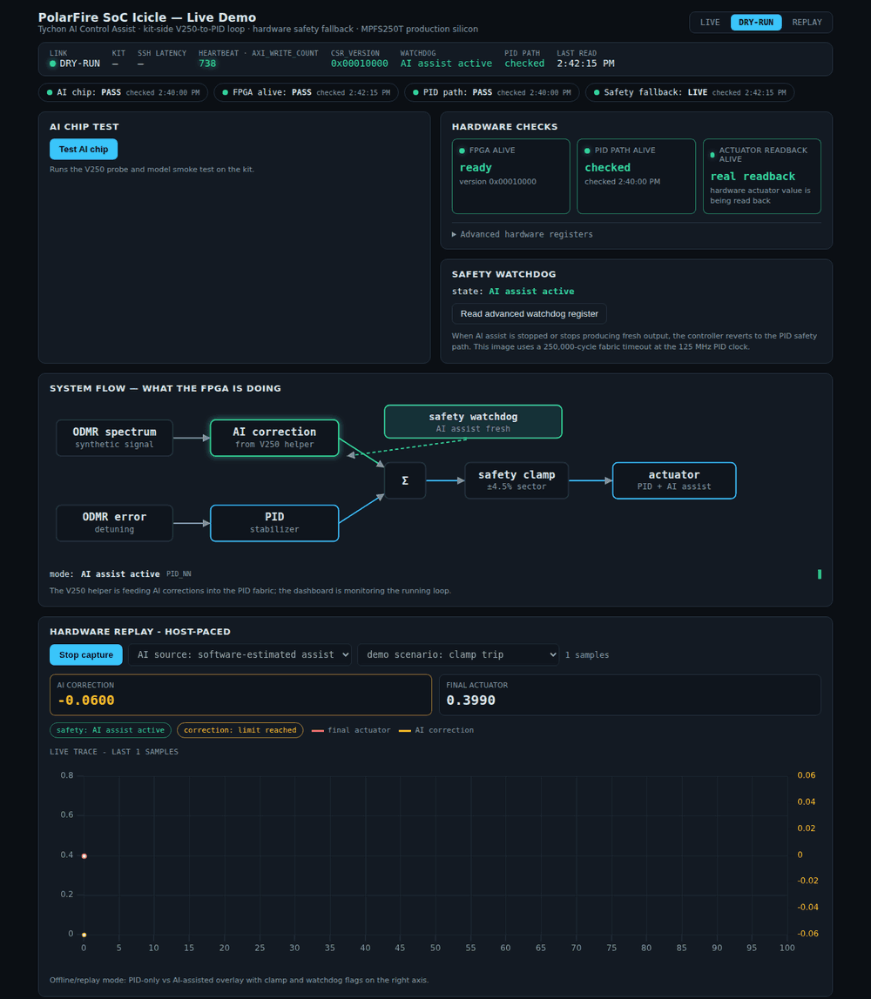
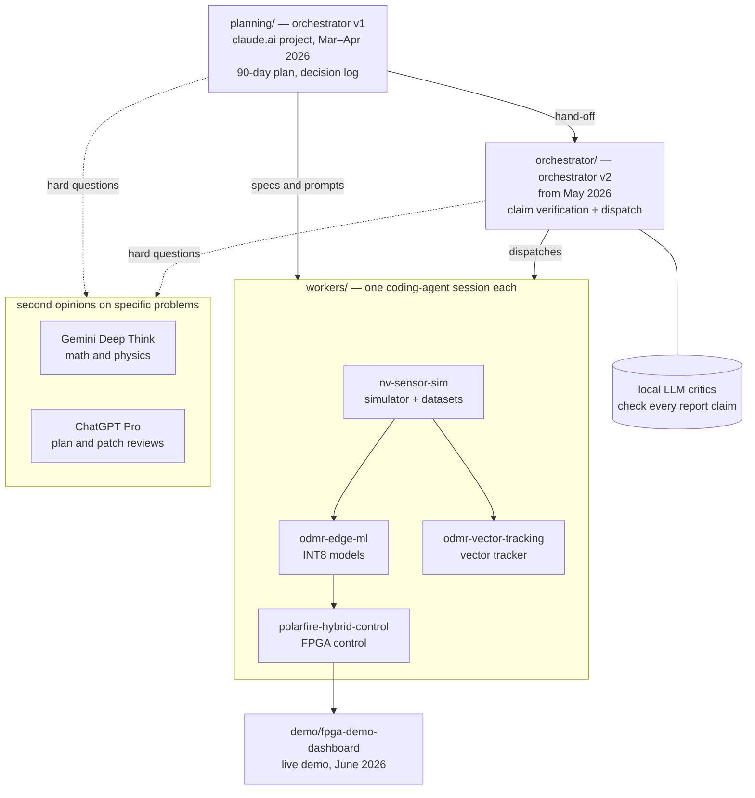

# Tychon NV stack: an agent-orchestrated quantum-sensing build

[](https://github.com/jasonphillip/tychon-nv-stack/actions/workflows/bench.yml)

I used coding agents to build the software for NV-diamond quantum magnetometers. One orchestrator session handed out the tasks, and each worker repository had its own agent session. The orchestration was human-mediated: until the dispatch tool existed in July 2026, I carried the prompts between the planning chat and the repository sessions by hand. Together they produced a physics simulator, edge ML models, PID plus neural-network control on a PolarFire SoC FPGA, a field-vector tracker and a live demo dashboard. I planned the work, wrote the specs and reviewed what came back. The agents wrote most of the code.

The build started from a 90-day plan in March 2026 and continued through September 2026.

## Results at a glance

| Part | Result | Limit |
|---|---|---|
| FPGA watchdog | Trip time measured on PolarFire SoC silicon on 2026-07-01: median 2.000 ms over 120 trips | One dev kit |
| FPGA control loop | 8-hour soak on silicon on 2026-07-02: 95.7 M steps at 3,319 Hz, and the loop never stopped advancing. Five short scheduling delays over 2 ms each tripped the watchdog | Paced by software on the SoC's processor, not in the fabric; replayed ODMR input, no live diamond. A counted trip does not show that the controller fell back (next row) |
| Watchdog fallback | Board test on 2026-10-09, 82 runs: when the next controller update saw the timeout, control passed to plain PID within one update (66 to 71 µs), with no jump in the actuator value, 60 of 60 | No fallback when the timeout cleared before the next update (0 of 20) or when the control process stopped. At recovery the actuator steps by about 0.01, ten times the slew limit |
| Edge ML benchmark | `make bench` trains a 10,689-parameter network on synthetic spectra. Mean field error on 200 test spectra is 10.53 µT, against 12.26 µT for a constant baseline and 25.93 µT for a derivative zero-crossing PID proxy | Synthetic data, FP32 on a CPU; INT8 accuracy on the kit is not in this table |
| Vector tracker | Follows the field vector through spectral line crossings, reliable to about 30 to 40° off the bias axis | FP32 simulation only; no INT8 export or on-target run |
| Simulator | Loaders for five public ODMR and magnetometry datasets, and two-sample tests to compare against them | Comparison results not yet committed |
| Claim checks | Audits of my technical report on 2026-05-01, up to 114 claims per pass through two local critic models. A manual structure review found three critical errors, all fixed in the corrected report | On the first run the two critics agreed 10 times out of 10, which I counted as a failed independence test |

Where I'd push back on these results myself: [the weakest claims](orchestrator/INVENTORY.md#6-weakest-claims--what-would-not-survive-a-sharp-reviewer), my own list. What review caught: [tracker baseline numbers I retracted](docs/case-study.md#what-the-reviews-caught) and [errors in agent output](orchestrator/README.md#checking-the-agents-as-well-as-the-report).

## The demo dashboard



This recording is the dashboard in dry-run mode. Every value in it, including the PASS and LIVE badges, comes from the dashboard's software model of the kit, not from hardware. In live mode the same screens read the kit over SSH. Source: [demo/fpga-demo-dashboard](demo/fpga-demo-dashboard/).

## How it fits together



## Where to look first

| If you have | Open |
|---|---|
| 1 minute | this page and [the timeline](#timeline) |
| 5 minutes | [docs/case-study.md](docs/case-study.md): how the work was planned, reviewed and verified |
| the claims I'd challenge first | [orchestrator/INVENTORY.md, section 6](orchestrator/INVENTORY.md#6-weakest-claims--what-would-not-survive-a-sharp-reviewer): what would not survive a sharp reviewer |
| no physics background | [docs/primer.md](docs/primer.md): NV diamonds, ODMR, and why a network on an FPGA |
| the machines I used and what ran where | [docs/lab.md](docs/lab.md) |
| how I used manuals, notebooks and local checks | [docs/method.md](docs/method.md) |
| what I read | [docs/references.md](docs/references.md): manuals, papers and the public datasets |
| a term I don't know | [docs/glossary.md](docs/glossary.md) |
| why the orchestrator exists and why its critics stay off the web | [orchestrator/README.md](orchestrator/README.md): it started as a check on my own work |
| the orchestration loop | [planning/excerpts/](planning/excerpts/): the planning chat writing prompts for each repo session and reviewing what came back |
| mistakes other models caught | [docs/second-opinions.md](docs/second-opinions.md) |
| a real dispatch | [orchestrator/tvw/audits/dispatch-9-increment8-bc-stack-2026-07-11.md](orchestrator/tvw/audits/dispatch-9-increment8-bc-stack-2026-07-11.md) and the tool that sends it, [dispatch.sh](orchestrator/tvw/scripts/dispatch.sh) |
| critic verdicts | [orchestrator/tvw/audits/stage-4.7-verdicts.csv](orchestrator/tvw/audits/stage-4.7-verdicts.csv) and [orchestrator/STAGES.md](orchestrator/STAGES.md) |
| hardware results | [workers/polarfire-hybrid-control/README.md](workers/polarfire-hybrid-control/README.md) |
| the plan and its decisions | [planning/docs/90-day-execution-playbook-v4.md](planning/docs/90-day-execution-playbook-v4.md) and [planning/docs/decision-log.md](planning/docs/decision-log.md) |
| the agents' own instructions | [orchestrator/AGENTS.md](orchestrator/AGENTS.md) and `workers/*/AGENTS.md` |

## How the agents were used

| Role | Tool | Where it shows |
|---|---|---|
| Planner and first orchestrator | a claude.ai project | [planning/](planning/) |
| Grounded Q&A over vendor manuals | Google NotebookLM | [docs/method.md](docs/method.md) |
| Math and physics checks | Gemini Deep Think, on the problems it was strongest at | [docs/second-opinions.md](docs/second-opinions.md) |
| Second reviews of plans and patches | ChatGPT Pro | [docs/second-opinions.md](docs/second-opinions.md) |
| Orchestrator | a Claude Code session with its own rules | [orchestrator/](orchestrator/) |
| Workers | one Claude Code or Codex session per repository | [workers/](workers/) |
| Claim critics | qwen3-coder:30b and nemotron-mini, run locally with Ollama | [orchestrator/STAGES.md](orchestrator/STAGES.md) |

By rule, the orchestrator session sends a written dispatch with a goal and an acceptance check, sometimes with a predicted effort, and the worker session does the work in its own repository. (The orchestrator's rules also let it commit to the implementation repositories for multi-repository bring-up work.) The critic models run only on my own machines.

## Timeline

| When | What |
|---|---|
| 2025-08 | First technical plan for ML-on-FPGA NV-diamond magnetometry, with research merged across two models |
| 2026-03-04 | Planning starts in a claude.ai project: technology watch, then the 90-day playbook and a dated decision log |
| 2026-03-26 | First attempts in three repositories ([archive/v0](archive/v0)) |
| 2026-04-01 to 04-04 | Gemini Deep Think reviews the designs; findings become per-repository prompts |
| 2026-04-03 | Restart in clean repositories: simulator, edge ML, FPGA control |
| 2026-05-01 | Orchestrator repository starts with a full claim audit of the technical report |
| 2026-06 | PolarFire SoC silicon brought up on the dev kit; demo dashboard built for a live demo |
| 2026-06-29 | The orchestrator starts a fourth worker, the vector tracker |
| 2026-07 | Busiest month: dispatches, retraining rounds and watchdog measurements on silicon |
| 2026-08 | Loaders for five external ODMR and magnetometry datasets, and two-sample test code (sliced-Wasserstein, MMD, KS) to compare the simulator against them; comparison results not yet committed |
| 2026-09 | Dispatch tool hardened with atomic IDs, leases and an 18-group test |

## Not finished

- An NV diamond has four crystal orientations, so one sensor can measure the direction of the field as well as its size. The edge models and the FPGA loop use the scalar field. The vector tracker in [workers/odmr-vector-tracking](workers/odmr-vector-tracking) works in FP32 simulation only, reliably to about 30-40° off the bias axis. No INT8 export or on-target parity run exists for it, and it isn't in the FPGA loop.
- The control loop runs on PolarFire silicon with replayed ODMR traces as its input. It is paced by software on the SoC's processor, not resident in the fabric, and the 8-hour soak ran at about 3.3 kHz. No live diamond sensor has been in that loop.

## Layout

```
planning/        orchestrator v1: the claude.ai project documents and a dated index of its 86 conversations
orchestrator/    orchestrator v2: claim-verification pipeline, dispatch tool, audits
workers/         nv-sensor-sim, odmr-edge-ml, polarfire-hybrid-control, odmr-vector-tracking
demo/            fpga-demo-dashboard: the live demo of the FPGA control loop
archive/v0/      the first attempts, kept to show where the work began
docs/            primer, case study, lab, method and tooling, references, glossary
```

## About this history

Every folder except `planning/` and `docs/` was its own repository, and their histories were merged here with each commit's original author and dates. Some planning documents, people's names and vendor tool logs were left out of the public history. Commit IDs cited inside older documents map to the IDs in this repository through [COMMIT-MAP.tsv](COMMIT-MAP.tsv). I've kept the failed and partial FPGA bring-up attempts on the `polarfire/bringup/*` branches.
