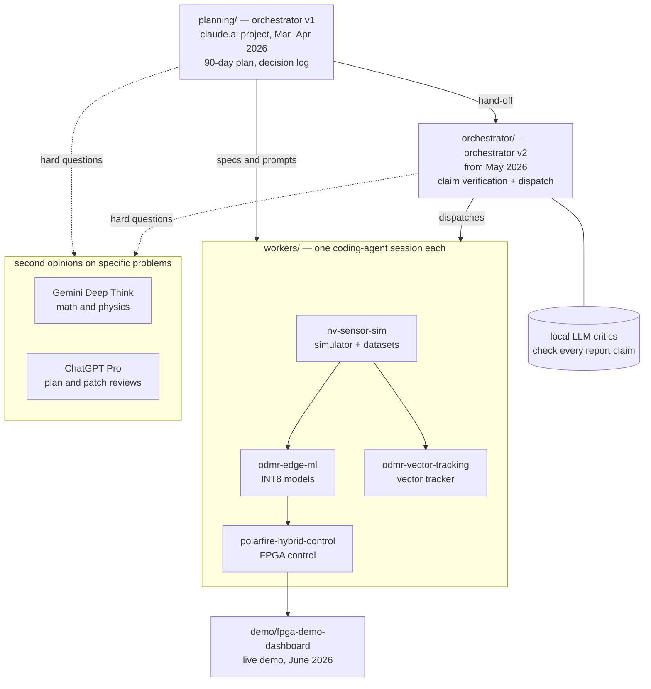

# Tychon NV stack: an agent-orchestrated quantum-sensing build

I used coding agents to build the software for NV-diamond quantum magnetometers. One orchestrator session handed out the tasks, and each worker repository had its own agent session. Together they produced a physics simulator, edge ML models, PID plus neural-network control on a PolarFire SoC FPGA, a field-vector tracker and a live demo dashboard. I planned the work, wrote the specs and reviewed what came back. The agents wrote most of the code.

The build started from a 90-day plan in March 2026 and continued through September 2026.

## How it fits together



## Where to look first

| If you have | Open |
|---|---|
| 1 minute | this page and [the timeline](#timeline) |
| 5 minutes | [docs/case-study.md](docs/case-study.md): how the work was planned, reviewed and verified |
| the orchestration loop | [planning/excerpts/](planning/excerpts/): the planning chat writing prompts for each repo session and reviewing what came back |
| mistakes other models caught | [docs/second-opinions.md](docs/second-opinions.md) |
| a real dispatch | [orchestrator/tvw/audits/dispatch-9-increment8-bc-stack-2026-07-11.md](orchestrator/tvw/audits/dispatch-9-increment8-bc-stack-2026-07-11.md) and the tool that sends it, [dispatch.sh](orchestrator/tvw/scripts/dispatch.sh) |
| critic verdicts | [orchestrator/tvw/audits/stage-4.7-verdicts.csv](orchestrator/tvw/audits/stage-4.7-verdicts.csv) and [orchestrator/STAGES.md](orchestrator/STAGES.md) |
| hardware results | [workers/polarfire-hybrid-control/README.md](workers/polarfire-hybrid-control/README.md) |
| the plan and its decisions | [planning/docs/90-day-execution-playbook-v4.md](planning/docs/90-day-execution-playbook-v4.md) and [planning/docs/decision-log.md](planning/docs/decision-log.md) |
| the agents' own instructions | [orchestrator/AGENTS.md](orchestrator/AGENTS.md) and `workers/*/AGENTS.md` |

## How the agents were used

| Role | Tool | Where it shows |
|---|---|---|
| Planner and first orchestrator | a claude.ai project | [planning/](planning/) |
| Math and physics checks | Gemini Deep Think, on the problems it was strongest at | [docs/second-opinions.md](docs/second-opinions.md) |
| Second reviews of plans and patches | ChatGPT Pro | [docs/second-opinions.md](docs/second-opinions.md) |
| Orchestrator | a Claude Code session with its own rules | [orchestrator/](orchestrator/) |
| Workers | one Claude Code or Codex session per repository | [workers/](workers/) |
| Claim critics | qwen3-coder:30b and nemotron-mini, run locally with Ollama | [orchestrator/STAGES.md](orchestrator/STAGES.md) |

By rule, the orchestrator session never edits a worker's code. It sends a written dispatch with a goal and an acceptance check, sometimes with a predicted effort, and the worker session does the work in its own repository. The critic models run only on my own machines.

## Timeline

| When | What |
|---|---|
| 2025-08 | First technical plan for ML-on-FPGA NV-diamond magnetometry, with research merged across two models |
| 2026-03-04 | Planning starts in a claude.ai project: technology watch, then the 90-day playbook and a dated decision log |
| 2026-03-26 | First attempts in three repositories ([archive/v0](archive/v0)) |
| 2026-04-01 to 04-04 | Gemini Deep Think reviews the designs; findings become per-repository prompts |
| 2026-04-03 | Restart in clean repositories: simulator, edge ML, FPGA control |
| 2026-05-01 | Orchestrator repository starts with a full claim audit of the technical report |
| 2026-06 | PolarFire SoC silicon brought up on the dev kit; demo dashboard built for a live demo |
| 2026-06-29 | The orchestrator starts a fourth worker, the vector tracker |
| 2026-07 | Busiest month: dispatches, retraining rounds and watchdog measurements on silicon |
| 2026-08 | Simulator checked against five external ODMR and magnetometry datasets with two-sample statistical tests |
| 2026-09 | Dispatch tool hardened with atomic IDs, leases and an 18-group test |

## Not finished

- An NV diamond has four crystal orientations, so one sensor can measure the direction of the field as well as its size. The edge models and the FPGA loop use the scalar field. The vector tracker in [workers/odmr-vector-tracking](workers/odmr-vector-tracking) works in simulation, reliably to about 30-40° off the bias axis, but it isn't in the FPGA loop.
- The control loop runs on PolarFire silicon with replayed ODMR traces as its input. No live diamond sensor has been in that loop.

## Layout

```
planning/        orchestrator v1: the claude.ai project documents and a dated index of its 86 conversations
orchestrator/    orchestrator v2: claim-verification pipeline, dispatch tool, audits
workers/         nv-sensor-sim, odmr-edge-ml, polarfire-hybrid-control, odmr-vector-tracking
demo/            fpga-demo-dashboard: the live demo of the FPGA control loop
archive/v0/      the first attempts, kept to show where the work began
docs/            case study
```

## About this history

Every folder except `planning/` and `docs/` was its own repository, and their histories were merged here with each commit's original author and dates. Some planning documents, people's names and vendor tool logs were left out of the public history. Commit IDs cited inside older documents map to the IDs in this repository through [COMMIT-MAP.tsv](COMMIT-MAP.tsv). I've kept the failed and partial FPGA bring-up attempts on the `polarfire/bringup/*` branches.
