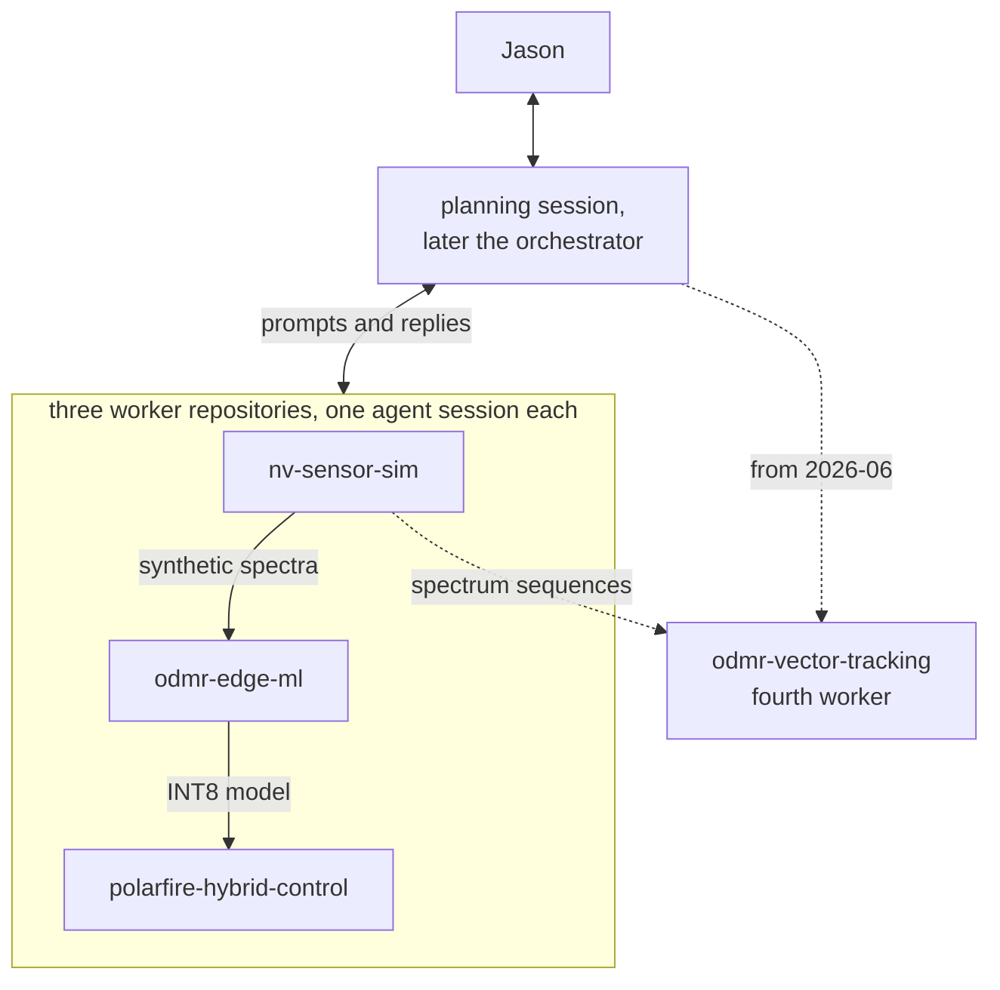

# Tychon quantum sensing: an agent-orchestrated NV-magnetometer build

[](https://github.com/jasonphillip/tychon-quantum-sensing/actions/workflows/bench.yml) [](https://github.com/jasonphillip/tychon-quantum-sensing/actions/workflows/tests.yml) [](https://doi.org/10.5281/zenodo.23323384)

Software toward AI-assisted control of an NV-diamond magnetometer, developed and tested without a sensor. Nitrogen-vacancy (NV) centres in diamond reveal the magnetic field in their optically detected magnetic resonance (ODMR) spectrum. The repository holds a simulator for synthetic ODMR spectra, small neural networks that estimate the field, and a PID (proportional-integral-derivative) controller with a neural-network correction on a PolarFire SoC kit, which pairs an FPGA (field-programmable gate array) with a processor. Coding agents wrote most of the code from my specifications; I planned, relayed and reviewed the work.

**Demonstrated state.** The controller ran on PolarFire SoC silicon with replayed synthetic spectra as input; no diamond sensor was connected. Model accuracy figures come from synthetic data. The parts are not one integrated or deployed system.

**What is shown, and what is not**

- Measured on silicon: watchdog trip time median 2.000 ms over 120 trips; an 8-hour soak at 3,319 Hz; fallback to plain PID within one update after a timeout (60 of 60, 20 of 20, 10 of 10) — [FPGA worker](workers/polarfire-hybrid-control/README.md), [engineering decision 2](docs/engineering-decisions.md#2-test-actual-fallback-rather-than-count-watchdog-trips).
- Measured on silicon: the deployed INT8 model's kit output equals its INT8 TFLite output bit for bit on 512 held-out synthetic spectra (final-field error 14.47 µT vs 15.21 µT for PID alone; 0.038 ms per sample); the dataset recipe is committed and reproduces the data byte for byte — [deployed model on the kit](workers/odmr-edge-ml/docs/deployed_model_on_kit_2026-10.md). But that model is only a bounded correction to PID: a training-mean constant scores 12.6 µT on the same rows, and the recipe had clipped its training targets to ±2.25 µT — [constant baselines](workers/odmr-edge-ml/docs/scalar_constant_baselines_2026-10.md), [training-target diagnosis](workers/odmr-edge-ml/docs/training_target_diagnosis_2026-10.json).
- Scalar repair and stress, both under protocols fixed before scoring: trained without the clipping, the same network beats the constant on a fresh synthetic holdout (direct magnitude 10.87 µT FP32 / 10.90 INT8 vs 12.72; deployed model 21.70), but under realistic line width, noise and background slope every estimator from the narrow-line recipe fails (direct 25–34 µT vs the 13.04 µT constant; PID proxy ~810 µT); background slope is the main cause — [target repair](workers/odmr-edge-ml/docs/scalar_target_repair_2026-10.md), [stress test](workers/odmr-edge-ml/docs/scalar_stress_test_2026-10.md). A bounded repair cycle (background correction and constrained peak fits, no retraining), frozen before a single read of a fresh sealed validation set with corrected thermal-drift sampling, removes the realistic-condition failure of the unchanged direct INT8 models (27–41 µT down to 12.9 µT on the same data), but no repaired method beats the 12.3 µT training constant, so the registered rule stopped the study before any final set; the saved predictions recompute offline — [decision record](workers/odmr-edge-ml/docs/scalar_repair_cycle_2026-10.md).
- Scalar measurement design, simulation with a classical fit only: when the field is known to lie along one NV axis, a +250 µT axial bias lowered the registered fit's mean absolute error from 2.56 µT to 1.07 µT on a sealed set of 256 fields (constant 45 µT: 12.82; paired 95 % interval of the difference −1.79 to −1.18 µT; no failed fits). This is a changed task: the arbitrary-direction results above are unchanged and not comparable, no network was trained or scored, the low-SNR secondary cell misses its 2 µT and 5 µT thresholds, and the information diagnostic before it keeps its recorded independent FAIL (three strict singular-value checks at one unknown-direction point) — [bias comparison](workers/odmr-edge-ml/docs/scalar_bias_design_2026-10.md), [information diagnostic](workers/odmr-edge-ml/docs/scalar_information_limit_2026-10.md).
- Two follow-on software screens on the same known-axis task, both stopped at gates fixed before their results. A learned initializer for the classical fit matched its accuracy but was not faster (p95 processing 0.968 ms vs 0.911 ms for the fastest adequate classical method; speedup 0.94, 2 required). An adaptive-acquisition comparison stopped earlier, because its posterior approximation failed all seven qualification checks; that is not evidence that adaptive classical acquisition is worse. Component timing on one machine only; no bandwidth, energy, hardware or measured-sensor claim — [screen report](workers/odmr-edge-ml/docs/nv_contribution_screen_2026-10.md).
- Synthetic only: `make bench` 10.53 µT vs 12.26 µT for a constant ([benchmark](bench/README.md)); known-bias vector models 75.5 µT RMS vs 115.2 µT ([bias-field results](workers/odmr-edge-ml/docs/vector_v1_bias_field.md)); the learned tracker loses 108 of 120 field-cone sequences ([three-seed ablation](workers/odmr-vector-tracking/docs/association_loss_multiseed.md)); in the pre-registered study, confirmed on two sealed sets, a classical exact-inversion estimator beats that tracker under realistic conditions (RMSE 0.93 vs 5.81 mT; 11 of 12 stress cells on each set) and the tracker as trained loses 96 to 100 % of sequences in every cell of both sets (locked on at most 4 % of frames); on clean spectra the two split (classical lower RMSE, tracker lower angular error) and the classical estimator still loses 44 to 48 % of sequences — [verdict](workers/odmr-vector-tracking/docs/comparison_study_protocol_2026-10.md#addendum-2026-10-15-j-v2-confirmation-outcome-and-verdict), [v1 decision](workers/odmr-vector-tracking/docs/comparison_study_decision_2026-10.md), [v2 decision](workers/odmr-vector-tracking/docs/comparison_study_decision_2026-10_v2.md).
- Compared with measured data: the simulator's line widths were fitted to four public ODMR datasets, in-sample ([validation](workers/nv-sensor-sim/docs/external_validation_results.md), [fit](workers/nv-sensor-sim/docs/simulator_fit_results.md)).
- Not shown: a live diamond; a sensitivity figure (nT/√Hz); any estimator evaluated on measured spectra (three public measured sets were checked and none qualified for an independent field-accuracy test — [feasibility](workers/odmr-edge-ml/docs/measured_data_feasibility_2026-10.md)); a repaired scalar estimator that passes the registered improvement gate under both primary synthetic conditions; a reliable vector tracker of any kind on these synthetic sequences (the confirmed study verdict names the classical exact-inversion estimator as the reference, but it still loses 44–69 % of sequences; see the [protocol](workers/odmr-vector-tracking/docs/comparison_study_protocol_2026-10.md) and the [reviewer path](docs/start-here-reviewers.md)).

I built this independently around an [SBIR (Small Business Innovation Research) Phase I proposal that was not selected](docs/proposal/README.md). It received no government funding.

## Three workstreams, one coordinator

The core work ran in three separate worker repositories, each with its own coding-agent session (Claude Code or Codex), coordinated by a planning session and me: a claude.ai project, then from May 2026 an orchestrator session. Until July 2026 I pasted every prompt and reply between sessions by hand. After that, tasks travelled as files, sent with a [dispatch tool](orchestrator/tvw/scripts/dispatch.sh) from 2026-07-10, and I told each worker when one was waiting. A fourth worker started on 2026-06-29. The histories were later merged into this repository.



| Workstream | Takes in | Produces |
|---|---|---|
| [Physics simulation and synthetic datasets](workers/nv-sensor-sim/) | Field, noise and sampling settings | Labelled spectra in train, validation and test splits, with a manifest |
| [Model training, evaluation and export](workers/odmr-edge-ml/) | The simulator's datasets | Trained networks and an INT8 (8-bit integer) model |
| [FPGA control, firmware and hardware checks](workers/polarfire-hybrid-control/) | The INT8 model, replayed synthetic spectra | FPGA design, kit software, silicon measurements |
| [Field-vector tracking](workers/odmr-vector-tracking/), the fourth worker | Spectrum sequences | A field-direction tracker, FP32 simulation only |

One coordination round: [an external review turned into per-repository prompts](planning/excerpts/03-external-review-to-repo-prompts.md) (April 2026). The planning chat wrote the prompts, reviewed a worker's reply, found that a documented test-set safeguard was never implemented, and wrote the fix prompt. The fix is simulator commit [9529f61](https://github.com/jasonphillip/tychon-quantum-sensing/commit/9529f61).

## Where to go

| To | Open |
|---|---|
| Understand the project in five minutes | [Case study](docs/case-study.md) |
| Compare the unfunded proposal with delivered work | [Proposal archive and claim crosswalk](docs/proposal/README.md), [2025 drafting excerpts](planning/excerpts/00-proposal-2025.md) |
| See how LLM conversations shaped the work | [Conversation record](planning/excerpts/README.md), [What the models could not do](planning/excerpts/what-the-models-could-not-do.md) |
| Review the evidence in twenty minutes | [Reviewer path](docs/start-here-reviewers.md) |
| Navigate as a visiting agent | [Repository map](AGENTS.md), [llms.txt](llms.txt) |
| Generate synthetic spectra | [Synthetic-data walkthrough](docs/synthetic-data.md) |
| Inspect FPGA measurements | [FPGA worker: status and evidence](workers/polarfire-hybrid-control/README.md#where-this-fits) |
| Read the claims I would challenge first | [Weakest claims](orchestrator/INVENTORY.md#6-weakest-claims--what-would-not-survive-a-sharp-reviewer) |
| See decisions and who made them | [Engineering decisions](docs/engineering-decisions.md), [conversation excerpts](planning/excerpts/) |
| Take your own model to the V250 | [From a TFLite file to inference on the kit](docs/model-to-v250.md) |
| Learn the physics and terms | [Primer](docs/primer.md), [glossary](docs/glossary.md) |

## Representative results

| Result | Kind | Limit | Evidence |
|---|---|---|---|
| Watchdog trip time median 2.000 ms over 120 trips; 8-hour soak at 3,319 Hz; fallback to plain PID within one update after a timeout | Hardware measurement | Replayed input, no diamond; paced by software on the SoC processor, not in the fabric; a frozen processor gets no fallback until it resumes | [FPGA worker](workers/polarfire-hybrid-control/README.md) |
| `make bench`: 10.53 µT mean field error on 200 test spectra, against 12.26 µT for a constant baseline | Synthetic evaluation | FP32 on a CPU; the INT8 model on the kit is not in this number | [Benchmark](bench/README.md) |
| Deployed INT8 model on the kit: 512 held-out spectra, kit output = INT8 TFLite output bit for bit; final-field error 14.47 µT against 14.47 float and 15.21 PID alone; 0.038 ms per sample | Hardware measurement on synthetic input | Replayed synthetic spectra; the model's correction is small (its outputs lie within about ±2.9 µT, and the ±2.25 µT clamp changes the error by only 0.01 µT), so the error stays near PID's, and a training-mean constant predictor beats it on total-field error (12.6 µT on these same 512 rows; on the separate full 5,000-row CPU evaluation, 12.3 µT against 22.4 µT for the deployed model); dataset recipe committed and reproduced | [Deployed model on the kit](workers/odmr-edge-ml/docs/deployed_model_on_kit_2026-10.md), [constant baselines](workers/odmr-edge-ml/docs/scalar_constant_baselines_2026-10.md) |
| Classical two-Lorentzian fit vs the networks, scalar task: bench cohort fit 21.45 µT, MLP 10.53, PID proxy 25.93, training mean 12.26; production cohort fit 22.86, deployed INT8 FCNN 22.38, PID 23.54, training mean 12.33 | Synthetic evaluation | The two-line fit measures an axial projection, not the magnitude; the two cohorts use different frequency grids, so each model is scored only on its own | [Scalar fit vs network](workers/odmr-edge-ml/docs/scalar_fit_vs_network_2026-10.md) |
| Scalar target repair on a fresh synthetic holdout (5,000 rows, three seeds, models frozen before the single read): unclipped residual targets 11.13 µT FP32 (INT8 export 13.54, output-range clipping); direct magnitude 10.87 µT FP32 / 10.90 INT8; training mean 12.72; deployed model 21.70; paired FP32 intervals all below zero | Synthetic evaluation, protocol fixed before model evaluation | Synthetic data; the holdout's PID baseline and label summary were disclosed before the freeze; the kit's clamp and slew limit bound any correction, so a broader estimator is usable on hardware only as a bounded command or a reported estimate; nothing deployed changed | [Target repair](workers/odmr-edge-ml/docs/scalar_target_repair_2026-10.md), [integration contract](workers/odmr-edge-ml/docs/scalar_target_repair_integration_contract_2026-10.md) |
| Scalar stress test, seven fixed cells, final 256 rows each, candidates frozen before the single read: clean cell direct INT8 11.10 µT vs constant 13.04 vs prior-aware fit 10.94 (not significant); realistic cell direct INT8 33.58 / FP32 38.47, constant 13.04, prior-aware fit 25.10, PID 809.7, residual model 824.8; pre-declared criterion failed | Synthetic evaluation, protocol fixed before model evaluation | Every estimator from the narrow-line recipe fails under realistic line width, noise and background; the PID proxy's failure takes the residual approach with it; dev-only diagnostic: background slope is the main cause | [Stress test](workers/odmr-edge-ml/docs/scalar_stress_test_2026-10.md) |
| Scalar repair cycle on a fresh sealed validation set (512 fields × 7 conditions; methods frozen before the single read): realistic anchor — repaired joint fit + INT8 12.90 µT, repaired robust prior fit 12.84, unchanged prior fit 12.01, training mean 12.30, unchanged direct INT8 27.07–41.42, PID 812.4; clean — repaired joint fit + INT8 10.59 vs unchanged direct INT8 10.55–10.60 vs training mean 12.30. Registered outcome: stop (no repaired method passes both primary conditions) | Synthetic evaluation, protocol fixed before evaluation | Synthetic, one NV orientation; validation only, the final set was never generated; timing and fit diagnostics are recorded, not recomputed by the offline checker | [Decision record](workers/odmr-edge-ml/docs/scalar_repair_cycle_2026-10.md), [evidence bundle](workers/odmr-edge-ml/docs/scalar_repair_cycle_2026-10/) |
| Known-axis scalar bias comparison on a sealed set (256 fields × 3 cells × 2 arms; design, fit and pass rule fixed before the single evaluation): primary cell (5 MHz, SNR 10) +250 µT bias 1.072 µT MAE vs zero bias 2.560 vs constant 45 µT 12.821; paired difference −1.488 µT [−1.792, −1.184]; all five primary conditions pass. Secondary cells: 7 MHz 1.236 vs 4.162; SNR 3 3.436 vs 6.934, which misses the thresholds | Synthetic evaluation, protocol fixed before evaluation | Synthetic, one NV orientation, field along a known axis (a changed task); classical weighted least-squares fit, no network; the information diagnostic before it keeps a recorded independent FAIL at one unknown-direction point; timings are from a shared host | [Bias comparison](workers/odmr-edge-ml/docs/scalar_bias_design_2026-10.md), [information diagnostic](workers/odmr-edge-ml/docs/scalar_information_limit_2026-10.md), [saved results](workers/odmr-edge-ml/experiments/scalar_bias_design/results/) |
| Known-axis software screens (128 fresh development frames; gates fixed before results): learned initializer + classical refinement vs six adequate classical controls — MAE 1.1484 vs 1.1486 µT (paired difference −0.00018 µT), p95 processing 0.968 vs 0.911 ms, speedup 0.94 against a required 2 → stop. Adaptive acquisition: posterior approximation failed 7 of 7 qualification checks → stop before any comparison | Synthetic development screen, protocol fixed before evaluation | One fixed network and configuration; component timing on one CPU host, not system bandwidth or energy; the acquisition result says nothing about which policy is better | [Screen report](workers/odmr-edge-ml/docs/nv_contribution_screen_2026-10.md), [hybrid evidence](workers/odmr-edge-ml/docs/nv_contribution_screen_2026-10/hybrid/), [sparse evidence](workers/odmr-edge-ml/docs/nv_contribution_screen_2026-10/sparse/) |
| Default simulated lines are 2 to 11 times narrower than in four public ODMR datasets; a per-spectrum fit matches the widths | Comparison with measured data | The fit is in-sample | [Validation](workers/nv-sensor-sim/docs/external_validation_results.md), [fit](workers/nv-sensor-sim/docs/simulator_fit_results.md) |
| Three local critics cut false acceptances from 27 to 10 on a 60-claim test set | Software experiment | Abstained on 58 % of claims; 62.5 % of the claims it accepted were unsupported | [How claims were checked](orchestrator/README.md) |

Every result with its limits, and the timeline: [case study](docs/case-study.md#results-and-limits).

## Try it

Generate four synthetic spectra in about a second (repository root, Python 3.11 or later):

```bash
python -m pip install -e workers/nv-sensor-sim
python -m nv_sensor_sim.pipelines.batch_generate \
  --config workers/nv-sensor-sim/configs/quickstart_tiny.yaml --output-dir /tmp/nv-sim-tiny
```

It writes `dataset.h5` and `manifest.json`. [`make bench`](bench/README.md) reproduces the benchmark above. `demo/fpga-demo-dashboard/run_demo.sh` serves the [demo dashboard](demo/fpga-demo-dashboard/) at http://localhost:8077 without hardware.


*Dry-run recording: every value, including the PASS and LIVE badges, comes from the dashboard's software model of the kit, not from hardware.*

## License, citation and history

Apache-2.0, except output from Microchip Libero SoC and Synopsys Synplify Pro and 17 constraint files from Microchip's Icicle Kit reference design; [NOTICE](NOTICE) names them. Cite with [CITATION.cff](CITATION.cff) or the DOI above.

Each folder except `planning/` and `docs/` was its own repository, merged with original authors and dates; [COMMIT-MAP.tsv](COMMIT-MAP.tsv) maps older commit IDs. First attempts: [archive/v0](archive/v0); failed FPGA bring-ups: `polarfire/bringup/*` branches. "Phase I", "KPP" (key performance parameter) and "deliverable" in files refer to the proposal's plan. History: [timeline](docs/case-study.md#timeline), [workflow retrospective](docs/workflow-retrospective.md).
