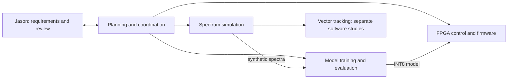

# Tychon quantum sensing: an agent-orchestrated NV-magnetometer build

[](https://github.com/jasonphillip/tychon-quantum-sensing/actions/workflows/bench.yml) [](https://github.com/jasonphillip/tychon-quantum-sensing/actions/workflows/tests.yml) [](https://doi.org/10.5281/zenodo.23323384)

Software toward AI-assisted control of an NV-diamond magnetometer, developed and tested without a sensor. Nitrogen-vacancy (NV) centres in diamond reveal magnetic fields through their optically detected magnetic resonance (ODMR) spectra. This repository connects spectrum simulation, field estimation, and a bounded neural correction to a classical controller on a PolarFire SoC development kit.

**Current validation limits.** This project has no live NV-diamond measurement setup. FPGA tests used replayed synthetic spectra. Separate software studies used public measured NV datasets, but incomplete reference labels, calibration records, and independent acquisitions limited the conclusions.

**Demonstrated state.** The FPGA control path and model inference ran on a development kit with replayed input. Separate software evaluations used synthetic and public measured data. These parts are not one integrated sensing system. Reliable sensing and a useful neural advantage over strong classical methods remain unproven.

I built this independently around an [SBIR Phase I proposal that was not selected](docs/proposal/README.md). This work received no government funding. The proposal archive is optional background; its crosswalk separates proposed targets from delivered results.

## Representative results

| Result | What it establishes | Limit and evidence |
|---|---|---|
| The kit's INT8 model output matched its CPU INT8 output bit for bit on 512 held-out spectra; inference took 0.038 ms per sample. | The model conversion and on-kit inference path worked on these inputs. | Inputs were synthetic. Final-field error was 14.47 µT, worse than a 12.6 µT constant predictor. Timing excludes sensing and the full control loop. [Kit results](workers/odmr-edge-ml/docs/deployed_model_on_kit_2026-10.md), [constant comparison](workers/odmr-edge-ml/docs/scalar_constant_baselines_2026-10.md). |
| Classical exact inversion beat the learned vector tracker on realistic synthetic conditions: 0.93 versus 5.81 mT RMSE. | A registered comparison, confirmed on two sealed sets, selected the classical reference. | The classical route still lost 44–69% of sequences across the primary cells. Neither result establishes reliable tracking. [Confirmed verdict](workers/odmr-vector-tracking/docs/comparison_study_protocol_2026-10.md#addendum-2026-10-15-j-v2-confirmation-outcome-and-verdict). |
| A Gaussian-process estimator used 124 calibration positions instead of 248, with mean localisation error of 51.7 versus 56.2 µm. | One measured acquisition passed the registered calibration-efficiency rule. | This was a narrow conditional pass on one 25-sweep acquisition. A stricter interval fails; there is no across-day or neural advantage claim. [Advantage search](docs/nv_advantage_search_2026-10.md). |

The [full results index](docs/results-index.md) retains scalar repairs, failed stress tests, measurement-design comparisons, controller measurements, and stopped candidates. Each report records its own data, comparator, acceptance rule, and limits. The [engineering decisions](docs/engineering-decisions.md) explain withdrawn claims and corrections. Negative results remain part of the record.

## Three workstreams, one coordinator

Coding agents wrote most of the code from my specifications. I set the direction, relayed work between sessions, and reviewed results. The [human steering record](planning/excerpts/human-steering.md) preserves concrete interventions; [what the models could not do](planning/excerpts/what-the-models-could-not-do.md) records their limits.

The original three worker repositories had separate agent sessions. A planning session coordinated their inputs and outputs. I initially pasted prompts and replies between sessions; later work used file-based dispatches. A fourth worker added vector tracking. Their histories are preserved here.



The [simulator](workers/nv-sensor-sim/), [scalar models](workers/odmr-edge-ml/), [FPGA controller](workers/polarfire-hybrid-control/), and [vector tracker](workers/odmr-vector-tracking/) remain separate components. Processor software starts each kit controller update. The fabric clamp remains, but watchdog recovery still depends on processor execution. [Controller scope and safety limits](workers/polarfire-hybrid-control/README.md#safety-architecture).

## Try it

Start with [reproducing saved evidence](docs/reproduce-evidence.md). It separates checking published predictions from retraining, fresh evaluation, and hardware operation.

From a fresh checkout with Python 3.11:

```bash
make install BENCH_PY=python3.11
make smoke
```

The smoke check imports the packages and generates a tiny synthetic dataset. It does not establish model accuracy. The reproduction guide gives the pinned external evidence checkout and the exact `make verify-evidence KIT_EVIDENCE_DIR=...` command.

For a small synthetic training benchmark, use [`make bench`](bench/README.md). Its reference error is 10.53 µT against a 12.26 µT constant; this is separate from the kit model. For a visual demonstration without hardware, open the [dashboard guide and dry-run recording](demo/fpga-demo-dashboard/README.md#dry-run-recording). Its traces and badges come from a software model.

## Where to go

| To | Open |
|---|---|
| Understand the project and timeline | [Case study](docs/case-study.md), [workflow retrospective](docs/workflow-retrospective.md) |
| Review results and reproduce saved metrics | [Results index](docs/results-index.md), [reproduction guide](docs/reproduce-evidence.md), [reviewer path](docs/start-here-reviewers.md) |
| Inspect decisions and conversation evidence | [Engineering decisions](docs/engineering-decisions.md), [conversation record](planning/excerpts/README.md) |
| Generate data or take a model to the kit | [Synthetic-data walkthrough](docs/synthetic-data.md), [TFLite-to-V250 guide](docs/model-to-v250.md) |
| Plan a meaningful next study or contribute | [Next sensing study](docs/next-sensing-study.md), [contribution guide](CONTRIBUTING.md) |
| Learn the physics or navigate as an agent | [Primer](docs/primer.md), [glossary](docs/glossary.md), [repository map](AGENTS.md), [llms.txt](llms.txt) |

## License, citation and history

Apache-2.0, with exceptions for Microchip and Synopsys generated output and 17 Microchip reference-design constraint files. [LICENSE](LICENSE) and [NOTICE](NOTICE) give the terms. Cite with [CITATION.cff](CITATION.cff) or the DOI above.

The worker repositories were merged with original authors and dates; [COMMIT-MAP.tsv](COMMIT-MAP.tsv) maps older commit IDs. [archive/v0](archive/v0) preserves first attempts. Historical “Phase I”, “KPP” and “deliverable” language refers to the unfunded proposal's plan, not an award or completed sensing system.
