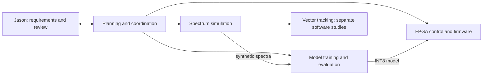

# Tychon quantum sensing: an agent-orchestrated NV-magnetometer build

[](https://github.com/jasonphillip/tychon-quantum-sensing/actions/workflows/bench.yml) [](https://github.com/jasonphillip/tychon-quantum-sensing/actions/workflows/tests.yml) [](https://doi.org/10.5281/zenodo.23323384) [](https://deepwiki.com/jasonphillip/tychon-quantum-sensing)

<p align="center">
  <a href="https://deepwiki.com/jasonphillip/tychon-quantum-sensing"></a>
</p>

Software toward AI-assisted control of an NV-diamond magnetometer, developed and tested without a sensor. Nitrogen-vacancy (NV) centres in diamond reveal magnetic fields through their optically detected magnetic resonance (ODMR) spectra. This repository connects spectrum simulation, field estimation, and a bounded neural correction to a classical controller on a PolarFire SoC development kit.

**Current validation limits.** This project has no live NV-diamond measurement setup. FPGA tests used replayed synthetic spectra. Separate software studies used public measured NV datasets, but incomplete reference labels, calibration records, and independent acquisitions limited the conclusions.

**Demonstrated state.** The FPGA control path and model inference ran on a development kit with replayed input. Separate software evaluations used synthetic and public measured data. These parts are not one integrated sensing system. Reliable sensing and a useful neural advantage over strong classical methods remain unproven.

## Try it

Three things you can do from a fresh checkout. The first two run on a CPU with Python 3.11, 3.12 or 3.13 and take about a minute together (measured 26 Oct 2026 on an Arm Linux machine without a GPU: 10 s for step 1, 20 s for step 2). The third needs a PolarFire SoC Icicle Kit and Microchip's tools.

**1. Generate NV spectra.** The simulator writes a tiny ODMR dataset in about a second. Use a virtual environment if you prefer; step 2 creates its own `.venv`.

```bash
python3 -m pip install -e workers/nv-sensor-sim
python3 -m nv_sensor_sim.pipelines.batch_generate \
  --config workers/nv-sensor-sim/configs/quickstart_tiny.yaml --output-dir /tmp/nv-sim-tiny
```

The last line printed is `Dataset written to /tmp/nv-sim-tiny`. That folder holds `dataset.h5` and `manifest.json`; the manifest records 2 train, 1 validation and 1 test spectra, `master_seed` 42, the qutip backend and the generator's git commit. The [synthetic-data walkthrough](docs/synthetic-data.md) explains the recipe, the one-spectrum Python call, and what synthetic spectra do not establish.

**2. Inspect or run the software checks.** The smoke check imports the packages and generates a tiny synthetic dataset. It does not establish model accuracy.

```bash
make install   # uses python3; add BENCH_PY=/path/to/python3.11 if your python3 is outside 3.11 to 3.13
make smoke
```

`make smoke` ends with a JSON block that starts with `"status": "PASS"` and lists the Python and package versions it ran with. A qutip warning that matplotlib is missing is expected and harmless.

To check the published kit evidence against its saved predictions, follow the [reproduction guide](docs/reproduce-evidence.md) to the `make verify-evidence KIT_EVIDENCE_DIR=...` command. It ends with `RESULT: PASS` only if every check passes, and a correctly reproduced scientific FAIL counts as a successful reproduction. For a small synthetic training benchmark, use [`make bench`](bench/README.md); its reference error is 10.53 µT against a 12.26 µT constant, separate from the kit model.

**3. Deploy a model to PolarFire.** The [TFLite-to-V250 guide](docs/model-to-v250.md) takes an INT8 TFLite model through `vnnx_compile`, the fabric build, programming the kit, and `vnnx_smoke` on the kit's Linux. It needs the Icicle Kit, Libero SoC and the VectorBlox SDK. The [FPGA controller README](workers/polarfire-hybrid-control/README.md#safety-architecture) sets the controller scope and safety limits.

**What the demonstrations show.** Two recordings. The [actual-board run](docs/board-demo-2026-10-22.md) below (62 seconds) shows the published INT8 model running on the Icicle Kit's V250 NPU over 512 **replayed synthetic** spectra, the kit output compared bit for bit with the published kit output and the CPU INT8 simulation, and what that does and does not establish. The [dashboard dry-run recording](demo/fpga-demo-dashboard/README.md#dry-run-recording) is a software model. Every value in it, including the PASS and LIVE badges, comes from that model, not from hardware.

<p align="center">
  <a href="docs/lab.md"></a>
</p>


The photo is the board the recording ran on: the production Icicle Kit in its enclosure ([lab page](docs/lab.md)).

If this is useful, star the repository, [report a reproduction result](https://github.com/jasonphillip/tychon-quantum-sensing/issues/1), or [say how you might use a component](https://github.com/jasonphillip/tychon-quantum-sensing/discussions) in Discussions. Small first tasks carry the [good first issue](https://github.com/jasonphillip/tychon-quantum-sensing/issues?q=is%3Aissue+is%3Aopen+label%3A%22good+first+issue%22) label.

## Representative results

| Result | What it establishes | Limit and evidence |
|---|---|---|
| The kit's INT8 model output matched its CPU INT8 output bit for bit on 512 held-out spectra; inference took 0.038 ms per sample. | The model conversion and on-kit inference path worked on these inputs. | Inputs were synthetic. Final-field error was 14.47 µT, worse than a 12.6 µT constant predictor. Timing excludes sensing and the full control loop. [Kit results](workers/odmr-edge-ml/docs/deployed_model_on_kit_2026-10.md), [constant comparison](workers/odmr-edge-ml/docs/scalar_constant_baselines_2026-10.md). |
| Classical exact inversion beat the learned vector tracker on realistic synthetic conditions: 0.93 versus 5.81 mT RMSE. | A registered comparison, confirmed on two sealed sets, selected the classical reference. | The classical route still lost 44–69% of sequences across the primary cells. Neither result establishes reliable tracking. [Confirmed verdict](workers/odmr-vector-tracking/docs/comparison_study_protocol_2026-10.md#addendum-2026-10-15-j-v2-confirmation-outcome-and-verdict). |
| A Gaussian-process estimator used 124 calibration positions instead of 248, with mean localisation error of 51.7 versus 56.2 µm. | One measured acquisition passed the registered calibration-efficiency rule. | This was a narrow conditional pass on one 25-sweep acquisition. A stricter interval fails; there is no across-day or neural advantage claim. [Advantage search](docs/nv_advantage_search_2026-10.md). |

The [full results index](docs/results-index.md) retains scalar repairs, failed stress tests, measurement-design comparisons, controller measurements, and stopped candidates. Each report records its own data, comparator, acceptance rule, and limits. The [engineering decisions](docs/engineering-decisions.md) explain withdrawn claims and corrections. Negative results remain part of the record.

## Beyond the proposal: CUDA-Q and FPGA experiments

Three additional demonstrations ran in FPGA fabric: qubit readout, coupled-spin NV estimation, and a small surface-code lookup.
Across two cold boots, **171,650 replay calls** matched references for **17,165 frozen synthetic records**.
In that initial run, CUDA-Q checked representative quantum calculations; the full datasets were CPU-generated.
The [separate experiment area](experiments/cudaq-fpga/README.md) includes source, per-call evidence, failures, and checks that run without hardware.
These demonstrations extend beyond the original proposal and establish no live quantum-system or radiation validation.

A [later continuation](experiments/cudaq-fpga/continuation/README.md) used CUDA-Q for all 32,768 quantum probabilities in a new synthetic dataset.
All 1,024 resulting records matched on the FPGA, including full-width scores. The specialized CPU solution was substantially faster for this small model.
A separate host-only classifier reached **95.83% preparation-label agreement on 8,192 held-out public qubit-readout records**.
The continuation retains the failed thermal-detector test, CPU/GPU timings, and limits on acquisition independence.

## Three workstreams, one coordinator

Coding agents wrote most of the code from my specifications. I set the direction, relayed work between sessions, and reviewed results. The [human steering record](planning/excerpts/human-steering.md) preserves concrete interventions; [what the models could not do](planning/excerpts/what-the-models-could-not-do.md) records their limits.

The original three worker repositories had separate agent sessions. A planning session coordinated their inputs and outputs. I initially pasted prompts and replies between sessions; later work used file-based dispatches. A fourth worker added vector tracking. Their histories are preserved here.



The [simulator](workers/nv-sensor-sim/), [scalar models](workers/odmr-edge-ml/), [FPGA controller](workers/polarfire-hybrid-control/), and [vector tracker](workers/odmr-vector-tracking/) remain separate components. Processor software starts each kit controller update. The fabric clamp remains, but watchdog recovery still depends on processor execution. [Controller scope and safety limits](workers/polarfire-hybrid-control/README.md#safety-architecture).

## Background: the proposal, the solo build, and the scale of the work

I submitted an SBIR Phase I proposal during the first week of August 2025. The proposed team included three additional engineering specialists. I expected notification in approximately 90 days; the decision arrived on May 12, 2026, roughly nine months later. The wait spanned the federal shutdown and SBIR authorization lapse. The proposal was not selected, and this work received no government funding. [Proposal history](https://github.com/jasonphillip/tychon-quantum-sensing/blob/main/docs/proposal/README.md).

Without funding for that team, I continued alone with AI agents, owning the architecture, experiments, debugging and evidence review, and extended the work into areas my plan had deferred to Phase II: on-board inference, controller measurements, and hierarchical INT8 model experiments. With no specialists to check the work, I built the Tychon Verification Workbench, which tests claims against project evidence; the [proposal crosswalk](https://github.com/jasonphillip/tychon-quantum-sensing/blob/main/docs/proposal/README.md#work-extended-beyond-the-phase-i-feasibility-plan) records what was delivered, what went beyond the feasibility plan, and what remains unresolved.

The project connects five workstreams: physics simulation, edge ML, FPGA control, vector tracking, and technical verification. A conservative audit of selected archived LLM records counted **1,357 submitted interactions**, **217 identified conversations and coding sessions**, and **113 distinct activity dates**, from July 2, 2025 through October 15, 2026. [Methodology and aggregate data](https://github.com/jasonphillip/tychon-quantum-sensing/blob/main/docs/workflow-retrospective.md#activity-count-methodology).

Built the traditional way, this repository would take a team of five specialists about nine months ([how that is estimated](docs/traditional-cost.md)).

## Where to go

| To | Open |
|---|---|
| Understand the project and timeline | [Case study](docs/case-study.md), [workflow retrospective](docs/workflow-retrospective.md) |
| Review results and reproduce saved metrics | [Results index](docs/results-index.md), [reproduction guide](docs/reproduce-evidence.md), [reviewer path](docs/start-here-reviewers.md) |
| Inspect decisions and conversation evidence | [Engineering decisions](docs/engineering-decisions.md), [conversation record](planning/excerpts/README.md) |
| Generate data or take a model to the kit | [Synthetic-data walkthrough](docs/synthetic-data.md), [TFLite-to-V250 guide](docs/model-to-v250.md) |
| Plan a meaningful next study or contribute | [Next sensing study](docs/next-sensing-study.md), [contribution guide](CONTRIBUTING.md), [Discussions](https://github.com/jasonphillip/tychon-quantum-sensing/discussions) |
| Learn the physics or navigate as an agent | [Primer](docs/primer.md), [glossary](docs/glossary.md), [repository map](AGENTS.md), [llms.txt](llms.txt) |
| Ask questions without a GitHub account | [DeepWiki chat](https://deepwiki.com/jasonphillip/tychon-quantum-sensing) answers on a web page. For your own assistant, change `github.com` to `gitingest.com` in this repository's URL ([digest](https://gitingest.com/jasonphillip/tychon-quantum-sensing)), then paste or upload the digest into ChatGPT, Claude or another chatbot. |
| See the scale of the work in traditional terms | [What this would traditionally cost to build](docs/traditional-cost.md), with the sources behind each number |

## License, citation and history

Apache-2.0, with exceptions for Microchip and Synopsys generated output and 17 Microchip reference-design constraint files. [LICENSE](LICENSE) and [NOTICE](NOTICE) give the terms. Cite with [CITATION.cff](CITATION.cff) or the DOI above.

The worker repositories were merged with original authors and dates; [COMMIT-MAP.tsv](COMMIT-MAP.tsv) maps older commit IDs. [archive/v0](archive/v0) preserves first attempts. Historical “Phase I”, “KPP” and “deliverable” language refers to the unfunded proposal's plan, not an award or completed sensing system.
