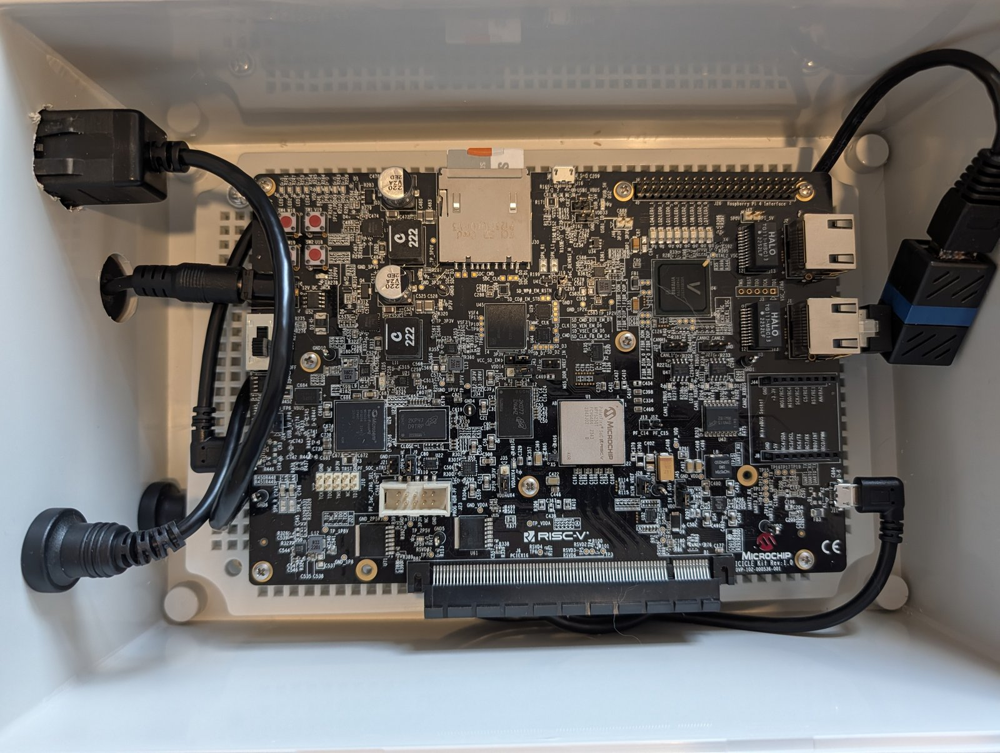
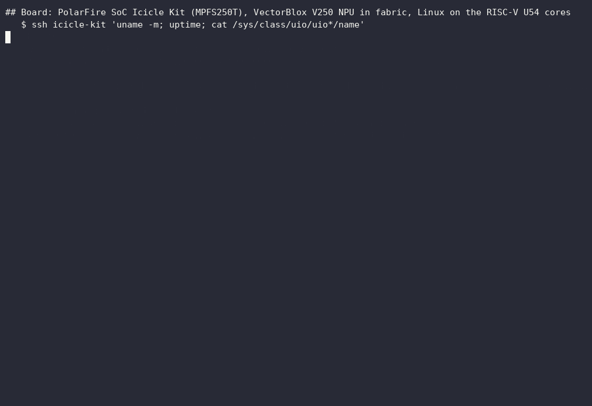

# Tychon quantum sensing: an agent-orchestrated NV-magnetometer build

[](https://github.com/jasonphillip/tychon-quantum-sensing/actions/workflows/bench.yml) [](https://github.com/jasonphillip/tychon-quantum-sensing/actions/workflows/tests.yml) [](https://doi.org/10.5281/zenodo.23323384) [](https://deepwiki.com/jasonphillip/tychon-quantum-sensing)

<p align="center">
  <a href="https://deepwiki.com/jasonphillip/tychon-quantum-sensing"></a>
</p>

This repository connects NV-diamond spectrum simulation, field estimation, and a bounded neural correction to a classical controller on a PolarFire SoC development kit. Nitrogen-vacancy (NV) centres reveal magnetic fields through optically detected magnetic resonance (ODMR) spectra.

On the kit, I measured a median watchdog trip time of 2.000 ms over 120 trips with replayed input. An eight-hour processor-paced V250-to-PID soak ran at 3,319 Hz on the same development kit. The [results index](docs/results-index.md) gives the conditions and evidence for each measurement.

I directed coding agents across the simulator, model, controller, and review work. Local language-model critics checked written claims against the project's files. The [case study](docs/case-study.md) traces the build and the [reviewer path](docs/start-here-reviewers.md) starts with the evidence.

## Try it

Three things you can do from a fresh checkout. The first two run on a CPU with Python 3.11, 3.12 or 3.13 and take about a minute together (measured 26 Oct 2026 on an Arm Linux machine without a GPU: 10 s for step 1, 20 s for step 2). The third needs a PolarFire SoC Icicle Kit and Microchip's tools.

**1. Generate NV spectra.** The simulator writes a tiny ODMR dataset in about a second. Use a virtual environment if you prefer; step 2 creates its own `.venv`.

```bash
python3 -m pip install -e workers/nv-sensor-sim
python3 -m nv_sensor_sim.pipelines.batch_generate \
  --config workers/nv-sensor-sim/configs/quickstart_tiny.yaml --output-dir /tmp/nv-sim-tiny
```

The last line printed is `Dataset written to /tmp/nv-sim-tiny`. That folder holds `dataset.h5` and `manifest.json`; the manifest records 2 train, 1 validation and 1 test spectra, `master_seed` 42, the qutip backend and the generator's git commit. The [synthetic-data walkthrough](docs/synthetic-data.md) explains the recipe and the one-spectrum Python call.

**2. Inspect or run the software checks.** The smoke check imports the packages and generates a tiny synthetic dataset.

```bash
make install   # uses python3; add BENCH_PY=/path/to/python3.11 if your python3 is outside 3.11 to 3.13
make smoke
```

`make smoke` ends with a JSON block that starts with `"status": "PASS"` and lists the Python and package versions it ran with. A qutip warning that matplotlib is missing is expected and harmless.

To check the published kit evidence against its saved predictions, follow the [reproduction guide](docs/reproduce-evidence.md) to the `make verify-evidence KIT_EVIDENCE_DIR=...` command. After every saved-evidence check passes, the command's final status line reads `RESULT: PASS`. A correctly reproduced scientific FAIL counts as a successful reproduction. For a small synthetic training benchmark, use [`make bench`](bench/README.md); its reference error is 10.53 µT against a 12.26 µT constant, separate from the kit model.

**3. Deploy a model to PolarFire.** The [TFLite-to-V250 guide](docs/model-to-v250.md) takes an INT8 TFLite model through `vnnx_compile`, the fabric build, programming the kit, and `vnnx_smoke` on the kit's Linux. It needs the Icicle Kit, Libero SoC and the VectorBlox SDK. The [FPGA controller README](workers/polarfire-hybrid-control/README.md#safety-architecture) sets the controller scope and safety limits.

**What the demonstrations show.** Two recordings. The [actual-board run](docs/board-demo-2026-10-22.md) below (62 seconds) shows the published INT8 model running on the Icicle Kit's V250 NPU over 512 **replayed synthetic** spectra, with the kit output compared bit for bit with the published kit output and the CPU INT8 simulation. The [dashboard dry-run recording](demo/fpga-demo-dashboard/README.md#dry-run-recording) is a software model. Every value in it, including the PASS and LIVE badges, comes from that model, not from hardware.

<p align="center">
  <a href="docs/lab.md"></a>
</p>



The photo shows the production Icicle Kit in its enclosure, the board the recording ran on ([lab page](docs/lab.md)).

If this is useful, star the repository, [report a reproduction result](https://github.com/jasonphillip/tychon-quantum-sensing/issues/1), or [say how you might use a component](https://github.com/jasonphillip/tychon-quantum-sensing/discussions) in Discussions. Small first tasks carry the [good first issue](https://github.com/jasonphillip/tychon-quantum-sensing/issues?q=is%3Aissue+is%3Aopen+label%3A%22good+first+issue%22) label.

## Representative results

| Result | Condition | Evidence |
|---|---|---|
| Watchdog trip time: median 2.000 ms over 120 trips | PolarFire SoC development kit, replayed input | [Watchdog measurement](workers/polarfire-hybrid-control/docs/watchdog_trip_measured_2026-07-01.md) |
| V250-to-PID loop: 95.7 million steps over 8.01 hours at 3,319 Hz | Kit-resident, processor-paced loop with replayed input | [Soak report](workers/polarfire-hybrid-control/docs/mss_paced_loop_measured_2026-07-02.md) |
| Fallback to plain PID within one update, 66 to 71 µs after timeout rise | PolarFire SoC development kit, controller starts when timeout is high | [Fallback test](workers/polarfire-hybrid-control/docs/watchdog_fallback_test_plan.md) |
| Kit output matched INT8 TFLite output bit for bit on 512 held-out spectra. NPU timing median 0.038 ms per sample | Replayed synthetic spectra on the PolarFire SoC development kit, with timing from NPU start to poll | [Kit report](workers/odmr-edge-ml/docs/deployed_model_on_kit_2026-10.md) |
| `make bench` mean field error: 10.53 µT against a 12.26 µT training-mean baseline | 200 synthetic test spectra, FP32 CPU run | [Benchmark](bench/README.md) |
| Biased classical fit: 1.072 µT MAE against 2.560 µT without bias | Known-axis synthetic scalar task on a sealed set with design, fit and pass rule fixed before evaluation | [Bias comparison](workers/odmr-edge-ml/docs/scalar_bias_design_2026-10.md) |

The [full results index](docs/results-index.md) retains every result and its Limit column. The [engineering decisions](docs/engineering-decisions.md) record the corrections and the reasoning behind them.

## Scope and evidence

Sensing inputs are synthetic spectra or public measured datasets. Kit runs used replayed input.

## CUDA-Q and FPGA experiments

Three additional demonstrations ran in FPGA fabric: qubit readout, coupled-spin NV estimation, and a small surface-code lookup.
Across two cold boots, **171,650 replay calls** matched references for **17,165 frozen synthetic records**.
In that initial run, CUDA-Q checked representative quantum calculations; the full datasets were CPU-generated.
The [experiment record](experiments/cudaq-fpga/README.md) includes source, per-call evidence, and checks that run without hardware.

A [later continuation](experiments/cudaq-fpga/continuation/README.md) used CUDA-Q for all 32,768 quantum probabilities in a new synthetic dataset.
All 1,024 resulting records matched on the FPGA, including full-width scores.
On public measured data, a separate host-only classifier reached **95.83% preparation-label agreement on 8,192 held-out qubit-readout records**.
The continuation records the thermal-detector test and CPU/GPU timings.

## How it was built

Coding agents wrote most of the code from my specifications. I set the direction, relayed work between sessions, and reviewed results. The [human steering record](planning/excerpts/human-steering.md) preserves concrete interventions; [what the models could not do](planning/excerpts/what-the-models-could-not-do.md) records their limits.

The original three worker repositories had separate agent sessions. A planning session coordinated their inputs and outputs. I initially pasted prompts and replies between sessions; later work used file-based dispatches. A fourth worker added vector tracking. Their histories are preserved here.

![Agentic hardware-in-the-loop R&D, drawn in four columns. The engineer works from a terminal session, with approval gates, project memory and research corpora. Retrieval, verification, skills and providers, and lane dispatch sit in an agent harness around an AI orchestrator. The hardware lab is a DGX Spark cluster, a Beelink with the Microchip FPGA toolchain, and the PolarFire SoC Icicle Kit. The lab automation column shows the bench layer, the build and test pipeline, the scheduler and the worker lanes, joined by two-way links.](docs/media/agentic-hardware-rd-2026-10-29.png)

The [simulator](workers/nv-sensor-sim/), [scalar models](workers/odmr-edge-ml/), [FPGA controller](workers/polarfire-hybrid-control/), and [vector tracker](workers/odmr-vector-tracking/) remain separate components. Processor software starts each kit controller update. The fabric clamp remains, but watchdog recovery still depends on processor execution. [Controller scope and safety limits](workers/polarfire-hybrid-control/README.md#safety-architecture).

## Where to go

| To | Open |
|---|---|
| Understand the project and timeline | [Case study](docs/case-study.md), [workflow retrospective](docs/workflow-retrospective.md) |
| Review results and reproduce saved metrics | [Results index](docs/results-index.md), [reproduction guide](docs/reproduce-evidence.md), [reviewer path](docs/start-here-reviewers.md) |
| Inspect decisions and conversation evidence | [Engineering decisions](docs/engineering-decisions.md), [conversation record](planning/excerpts/README.md) |
| Generate data or take a model to the kit | [Synthetic-data walkthrough](docs/synthetic-data.md), [TFLite-to-V250 guide](docs/model-to-v250.md) |
| Plan a meaningful next study or contribute | [Next sensing study](docs/next-sensing-study.md), [contribution guide](CONTRIBUTING.md), [Discussions](https://github.com/jasonphillip/tychon-quantum-sensing/discussions) |
| Learn the physics or read it as an agent | [Primer](docs/primer.md), [glossary](docs/glossary.md), [repository map](AGENTS.md), [llms.txt](llms.txt) |
| Ask questions without a GitHub account | [DeepWiki chat](https://deepwiki.com/jasonphillip/tychon-quantum-sensing) answers on a web page. For your own assistant, change `github.com` to `gitingest.com` in this repository's URL ([digest](https://gitingest.com/jasonphillip/tychon-quantum-sensing)), then paste or upload the digest into ChatGPT, Claude or another chatbot. |
| See the scale of the work in traditional terms | [What this would traditionally cost to build](docs/traditional-cost.md), with the sources behind each number |

## License, citation and history

Apache-2.0, with exceptions for Microchip and Synopsys generated output and 17 Microchip reference-design constraint files. [LICENSE](LICENSE) and [NOTICE](NOTICE) give the terms. Cite with [CITATION.cff](CITATION.cff) or the DOI above.

The worker repositories were merged with original authors and dates. [COMMIT-MAP.tsv](COMMIT-MAP.tsv) maps older commit IDs. [archive/v0](archive/v0) preserves first attempts. Historical "Phase I", "KPP" and "deliverable" language refers to the proposal plan.

## Background

I submitted an SBIR Phase I proposal during the first week of August 2025. The proposed team included three additional engineering specialists. I expected a decision in approximately 90 days. The notice arrived on May 12, 2026, roughly nine months later. The wait spanned the federal shutdown and SBIR authorization lapse. The proposal was not selected, and no award or contract resulted. The [proposal record](docs/proposal/README.md) holds the chronology and crosswalk.

I continued the build with coding agents and extended the work into on-board inference, controller measurements, and hierarchical INT8 model experiments. A conservative audit of selected archived LLM records counted **1,357 submitted interactions**, **217 identified conversations and coding sessions**, and **113 distinct activity dates**, from July 2, 2025 through October 15, 2026. [Methodology and aggregate data](docs/workflow-retrospective.md#activity-count-methodology).

The [traditional team estimate](docs/traditional-cost.md) uses five specialists over about nine months.
