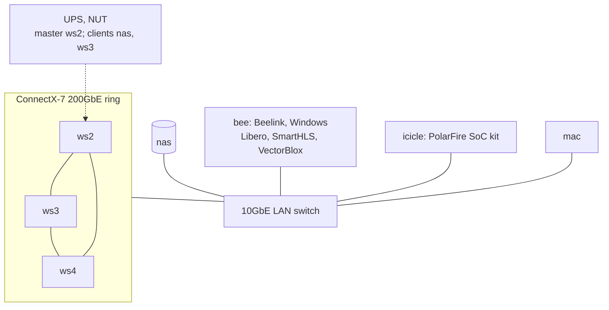
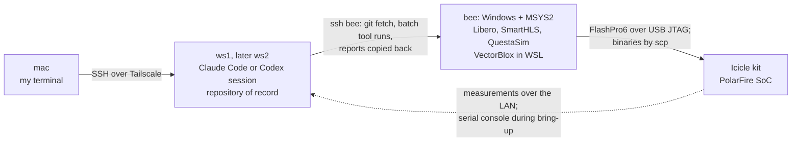

# The lab

I built a small home lab to develop, train and check the software in this repo, and to run parts of the quantum-sensing work on my own machines. It has no live diamond sensor and only one FPGA kit, so every hardware result here comes from replayed ODMR traces.

<!-- photo: rack, to be added -->

*The board every [HW] number was measured on: a Microchip PolarFire SoC Icicle Kit (MPFS250T) in a vented enclosure, powered and on the bench network.*

## At a glance

| Host | Hardware | What it did in this project | Since |
|---|---|---|---|
| ws1 | NVIDIA DGX Spark (GB10, Arm, 128 GB unified memory) | First machine and primary dev host. Corpus pipeline, edge-ML cascade timing, early vector-tracker runs, demo dashboard dev. Failed its field diagnostic with a hard power cut at 92 °C and went back for warranty replacement on 2026-07-05. | Ordered mid-October 2025 (recorded). Arrival date not recorded. |
| ws2 | DGX Spark | Primary host from 2026-07-05. Embedding service, local critics, hybrid search index, UPS master, vector-tracker training up to increment 7. | Present by 2026-02-24 (recorded). Arrival date not recorded. |
| ws3 | DGX Spark | Document vault. Bought so it could switch between connected and air-gapped use. Ring member, UPS client. | Unopened on 2026-06-10 (recorded). |
| ws4 | DGX Spark | Replacement for ws1. I gave it a new number so old ws1 config could not collide. Ring member. | Arrived 2026-08-10 (recorded). |
| bee | Beelink GTi15 Ultra, Intel Core Ultra 9 285H, 64 GB, Windows with MSYS2 | The only x86 host. Libero SoC 2025.2, SmartHLS 2025.2 and the VectorBlox SDK run only here. Synthesis, place-and-route, HLS, `.vnnx` compiles. | VectorBlox SDK installed April 2026 (recorded). Purchase date not recorded. |
| icicle | PolarFire SoC Icicle kit (MPFS250T) | The FPGA target. Watchdog and soak measurements. | On the bench by June 2026 (recorded). |
| nas | ASUSTOR AS6804T, four bays, 22 TB RAID 5, 1.8 TB SSD cache, 10GbE | Backups of every Spark, archives of training runs and evaluation sets, NFS mounts. Runs 24/7 since 2026-07-09. | First seen in my records 2026-03-23 (not the purchase date). |
| mac | MacBook Air M4 | Mobile dev. Ran the live demo dashboard offline at a June 2026 demo. | Throughout |
| UPS | CyberPower CP1500PFCLCDa with NUT | ws2 is the NUT master. NAS and ws3 are clients and shut down cleanly on power loss (NAS client test passed 2026-07-09). | NUT commands seen 2026-02-26 |

## Topology

ws1 was in the lab until 2026-07-05 and is not drawn. Before ws4 arrived, ws1 and ws2 had two direct 200 Gb/s links (RoCE active by 2026-06-09, recorded). I built the three-node ring on 2026-08-11 with NVIDIA's Sync Cluster Assistant. A two-node all-reduce ran at about 175 Gb/s. That figure is from my lab notes and I have not re-run it for this repo. A Tailscale mesh and a Syncthing folder connect all hosts.

## Timeline

| Date | Event | Status |
|---|---|---|
| 2025-10-13 to 10-14 | ws1 ordered | Recorded. Arrival not recorded. |
| 2025-10-26 to 10-28 | ws1 in use: a notebook on serving a model on it, then docker installs | Inferred from the notebook; the installs are recorded |
| 2026-02-24 | SSH set up between two Sparks | Recorded |
| 2026-03-23 | NAS first appears in my records | Recorded, not the purchase date |
| 2026-04 | VectorBlox SDK installed on bee | Recorded |
| 2026-06 | PolarFire silicon brought up on the Icicle kit | Recorded |
| 2026-06-09 | Two direct 200 Gb/s links between ws1 and ws2 verified | Recorded |
| 2026-06-10 | ws3 unopened, planned for air-gapped use | Recorded |
| 2026-07-05 | ws1 decommissioned, ws2 becomes primary | Recorded |
| 2026-07-09 | NAS switches to 24/7 | Recorded |
| 2026-07-11 | Cloud fan-out harness built for the 26-run increment 8 matrix | Recorded |
| 2026-07-18 | Rack re-cabled | Recorded |
| 2026-08-10 | ws4 arrives | Recorded |
| 2026-08-11 | Three-node ring built | Recorded |
| 2026-09-14 | Rack re-cabled again | Recorded |

## What ran where

- **Simulator.** `nv-sensor-sim` is CPU code, developed on the Sparks. Its CUDA-Q backend is a stub marked planned. On 2026-07-11 I benchmarked CUDA-Q's batched Lindblad dynamics on ws2 (a batch of 128 systems over 201 steps in 1.39 s, 1,024 in 4.51 s). The [assessment](../orchestrator/tvw/audits/cudaq-gpu-sim-assessment-2026-07-11.md) kept CUDA-Q as the throughput fallback and pointed the next fidelity generator at a differentiable JAX library instead. Where the datasets were generated is not recorded, so I do not claim GPU generation.
- **Edge ML.** The path is PyTorch, QAT, ONNX, TFLite INT8, then `.vnnx` on bee. I timed the cascade experiments on ws1's GB10 (8 m 28 s, bf16 with torch.compile). The training host for the rest is not recorded.
- **Vector tracker.** Increments up to 7 trained on a single GB10, 2 to 7 hours per run. Increment 8, a 26-run matrix in July 2026, trained in the cloud on L40S instances, so I could run 26 trainings in parallel. I used the cloud only for training. Checkpoints came back, and a pre-registered script re-derived every number on ws2. See [increment 8 results](../workers/odmr-vector-tracking/docs/increment8_results.md).
- **Claim verification.** Embeddings ran on ws2. The critics ran under Ollama on the machine that hosted the orchestrator: ws1 for the May 2026 audits, ws2 from July. Nothing in this step went to a cloud API.
- **FPGA flow.** Libero, SmartHLS and VectorBlox on bee. Bitstreams and binaries went from bee to the kit. Measurements came back from the kit over the LAN. See [How a change reached the board](#how-a-change-reached-the-board) and the [PolarFire README](../workers/polarfire-hybrid-control/README.md).
- **Demo.** I built the dashboard on ws1, then ws2, and showed it from the mac. See the [dashboard README](../demo/fpga-demo-dashboard/README.md).

## How a change reached the board

I worked from the mac. The coding agents ran on a Spark, and the Microchip tools run only on bee, a Windows machine. So a change to the FPGA design crossed four machines, and the agents drove every hop over SSH.

- **Code moves by git, not by copying files.** [`tools/run_beelink_verification.sh`](../workers/polarfire-hybrid-control/tools/run_beelink_verification.sh) checks that bee answers, pushes the branch, has bee fetch it from the Spark, runs SmartHLS and the Libero flow there, extracts the reports, pulls them back through git and checks them with a report-audit script. Each stage has its own exit code, so a failure names its step. On 2026-10-09 bee could not reach the Spark, so the branches went over as a git bundle.
- **Programming.** Libero's programming Tcl drives a FlashPro6 over USB JTAG, with a scan-chain check before each program job. Production silicon was first programmed on 2026-06-15.
- **Firmware and models.** Firmware is cross-compiled on bee with the RISC-V toolchain that ships with SmartHLS and copied to the kit's Linux. `vnnx_compile` runs in WSL Ubuntu on bee.
- **Place and route in parallel.** [Four Libero copies](../workers/polarfire-hybrid-control/libero/scripts/parallel/README.md) run seed sweeps at once instead of one after another. Each copy's project file stores its own absolute path, so a script rewrites it.
- **Windows problems the agents had to work around.** Libero stayed running after a Tcl script until the script closed the project and exited. A Libero project on bee became corrupt, and I documented the recovery options. The license file needed a patch, and the serial driver was installed over SSH. A stored netlist did not match a fresh synthesis of the same RTL with the same tool versions, so the timing audit was re-based on the fresh netlist ([audit-006](../orchestrator/tvw/audits/audit-006-fpga-timing-claim-revalidation.md)). The kit needs a cold power cycle after fabric programming. On 2026-10-09 I found that `shls sw_run` exits 0 even when its testbench fails, so the wrapper cannot yet catch a failing testbench.
- **Logs.** bee's project folders and the board-test logs are copied to the NAS.

## Local model serving

The embedding service runs Qwen3-Embedding-4B on ws2. It feeds the corpora behind the claim checks. The two critics, qwen3-coder:30b and nemotron-mini, run under Ollama on the orchestrator's host, ws1 and then ws2. I planned an NVIDIA NIM route and skipped it on 2026-05-01.

The rule is that critic inference runs only on local hosts. The coding agents (Claude Code and Codex) do run in the cloud, but they write and orchestrate and do not judge claims. See [STAGES.md](../orchestrator/STAGES.md) and the [pipeline README](../orchestrator/pipeline/README.md).

## What went wrong

- **ws1 failed and was replaced.** On 2026-07-05 its field diagnostic ended in a hard power cut at 92 °C, and it went back for warranty replacement. ws4 arrived on 2026-08-10. For five weeks the lab ran on two Sparks.
- **Rack re-cabling.** I re-cabled on 2026-07-18 and 2026-09-14. On 2026-07-18 the router and switch were power-cycled mid-shuffle. ws2, ws3 and the NAS lost power and rebooted, and every long-running job that day started over.
- **Single points of failure.** One FPGA workstation, one FPGA kit, and a UPS master on one host.
- **No live sensor.** The FPGA loop never saw a real diamond.
