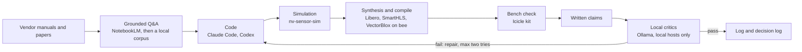

# Method and tooling

I started from vendor manuals and asked a grounded Q&A tool questions about them. The answers cited the manuals. From those answers I wrote code, ran it in simulation, synthesised it, and checked it on the bench. Then I wrote claims about the results, and local critic models checked those claims against the repo's evidence.

## Workflow

## Grounded Q&A over vendor manuals

NotebookLM was my first tool for the FPGA work. All the information I needed went into a notebook, manuals included, and I asked it project questions. I chose it because it grounds its answers in the uploaded sources, which mattered for answers that had to be right.

I had used it the same way for star-tracker datasheets since February 2025. My first FPGA notebook dates from 2025-04-23 and held the PolarFire SoC Icicle kit user guide and the PolarFire custom-flow user guide. The same day I asked ChatGPT for sources to learn FPGA basics, and then how to put vision models on them.

By 2025-08-17 I was working in a larger notebook, "PolarFire SoC MSS Configurator Software and Documentation", with 22 sources:

- Libero installation and licensing guide 2024.2
- PolarFire SoC Icicle kit user guide
- PolarFire SoC software development tool flow user guide
- the MSS Configurator product page
- the VectorBlox Accelerator SDK page and GitHub repo
- the VectorBlox SoC Video Kit demo repo
- the hart-software-services repo
- the icicle-kit-reference-design repo
- the Icicle kit Linux booting guide
- the embedded-software user guide and the updating-Linux guide from polarfire-soc-documentation
- the Yocto BSP releases page
- the Microchip licensing page
- an article on deploying MobileUNet to the PolarFire SoC Video Kit
- two Colab notebooks exported as PDF (train_CNN and Convert_Model_Vectorblox)
- a Gemini deep-research report on setting up the Icicle kit on Windows

The saved notes from that notebook cover flashing an SD card through the kit, the next steps for programming the device from Libero, and deploying a quantized MobileUNet through VectorBlox.

On 2025-08-14 I compared ChatGPT Projects with NotebookLM for Q&A over the Icicle and VectorBlox PDFs. ChatGPT recommended a Project. I kept NotebookLM for the manuals.

I made other notebooks for the NV physics and the lab setup. They covered Bayesian flow networks for NV magnetometry simulation (2025-10-12), ODMR hardware papers (2025-11-25) and a cuQuantum install guide with NV-center material (2025-11-20). For the lab, there was one on serving a model on the Spark (2025-10-26) and one on NVIDIA AI Workbench (2025-11-13).

NotebookLM citations point into the uploaded source. That let me check an answer against the cited page before I acted on it. The tool made the check possible, but I did not keep a log of it.

NotebookLM kept my saved notes but not the chat turns, so the questions are gone and no transcript is in this repo.

### One saved answer

This is one saved answer from the PolarFire notebook, from August or September 2025, trimmed. Judging by the answer, the question was whether an unformatted SD card could be imaged by putting it in the Icicle kit and exposing it to a Windows PC.

> Yes, it is possible to put an image on an unformatted SD card by first inserting it into your PolarFire SoC Icicle Kit and then exposing it as a mass storage device to your Windows PC. This method is explicitly supported by the PolarFire SoC ecosystem [1-3]. [...] At the HSS command line, type `mmc` and press Enter to select the eMMC/SD card as the boot source [1, 3]. Then, type `usbdmsc` and press Enter. This command will expose the eMMC/SD card as a USB mass storage device to your host PC [1-3]. You should see a message like 'Waiting for USB Host to connect' [3]. [...] use a tool like USBImager [...] select the pre-built Yocto Linux image (`.wic` or `.wic.gz`) [1, 15] [...] After the writing process is complete [...] press CTRL+C, and then type `boot` [16-18].

The bracketed numbers are NotebookLM's citation markers. In the live tool each one opens the passage in the source. In the export they are bare numbers, so I re-checked the `usbdmsc` claim for this page by text search against the exported sources. The hart-software-services repo lists the `usbdmsc` command, and the VectorBlox SoC Video Kit demo repo says the HSS uses it to expose the eMMC as a USB mass storage device. I did not re-check the serial settings or the page references in the full note.

## From notebooks to a local corpus

On 2026-02-17 I asked whether NotebookLM has an API or an MCP server. From 2026-02-23 I used a command-line skill for it from Claude Code. On 2026-03-05 I planned to sync my local corpora into notebooks, so I could see all the material retrieved for one topic. On 2026-04-26 the command-line route broke on expired auth, so nine notebooks went into a local corpus instead.

The last notebook I created is dated 2026-04-02. By then the local pipeline handled grounded lookup. I stopped using NotebookLM around then. That is inferred from the dates, and I have no record of it.

The pipeline is in [orchestrator/pipeline](../orchestrator/pipeline/README.md). It chunks docs and code, embeds them with Qwen3-Embedding-4B, and stores them in SQLite with FTS5 plus vectors. `search_code.py` runs hybrid BM25 and vector search. `extract_claims_from_doc.py` pulls claims from a document and `critic_loop.py` runs them past the critics.

## Agent orchestration

The roles (a planning project, an orchestrator session, one worker session per repository, and second-opinion models) are on the [front page](../README.md). The tables there are the reference, so I do not repeat them.

Who decided what is in the [case study](case-study.md). I set the plan, wrote the specs and reviewed the results. The agents wrote most of the code.

## Verification rules

- A claim verified by execution outranks one verified by retrieval, so a test run beats a search hit.
- Critics run only on local hosts.
- Two critics that return identical verdicts count as a failed independence test. In the first audit they did so 10 times out of 10.
- A repair is accepted only when its evidence is stronger than before. The loop stops after two failed repairs.
- Each stage ends at a stop-gate. See [STAGES.md](../orchestrator/STAGES.md).

## Limits

- The NotebookLM command-line route was fragile. It broke on expired auth in April 2026.
- NotebookLM kept saved notes but no chat turns. Only saved answers survive, so the questions are gone.
- The 26-run increment 8 matrix needed cloud training, because the local GPUs were the bottleneck (inferred from the fan-out harness).
- The simulator's CUDA-Q backend was never built and is still a stub.
