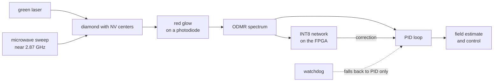

# NV-diamond sensing in plain words

This page explains the sensor to readers who know software or AI but not the physics, and says why this repository puts a small neural network on an FPGA.

A nitrogen-vacancy (NV) center is a defect in diamond, where a nitrogen atom sits next to a missing carbon atom. It has an electron spin that reacts to magnetic fields, and it works at room temperature.

To measure a field, green laser light makes the diamond glow red while a microwave signal is swept across frequencies near 2.87 GHz. When the microwave matches the spin resonance, the red glow dims slightly. This is optically detected magnetic resonance (ODMR). A magnetic field splits each dip into two, by about 28 MHz per millitesla, so you read the field from the size of the split.

Why up to eight dips? The NV axis can point along four directions in the diamond crystal. Each direction sees a different part of the field, so one spectrum can show four pairs of dips. From all four pairs you can work out the direction of the field as well as its size.

Real spectra are noisy. Temperature moves the 2.87 GHz center, the dips are lopsided, and in a large field dips from different axes cross. A classic lock-in loop with a PID controller tracks one frequency and can lose lock when lines cross. A small neural network takes the whole spectrum as input instead. Here the network corrects the PID loop and doesn't replace it, and a watchdog switches back to plain PID when the network is late.

The FPGA is there because the control loop has to run with a short, fixed delay at low power, close to the sensor. The PolarFire SoC combines RISC-V processor cores, programmable logic and the VectorBlox neural-network engine on one chip.

That engine runs networks with 8-bit integer weights, hence INT8. Networks with these weights are smaller and faster than with 32-bit floating point, but less precise. The network is trained with quantization-aware training so it copes with that limit.
