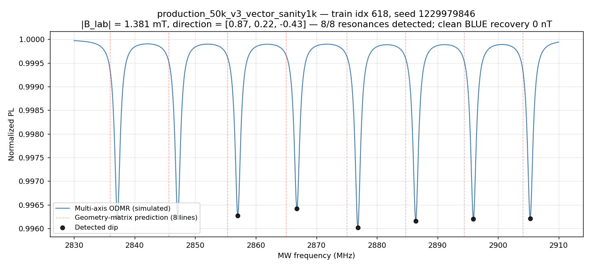

# Synthetic ODMR data: how it is made and what it supports

[Project overview](../README.md) · [Simulator worker](../workers/nv-sensor-sim/README.md) · [Dataset contract](../workers/nv-sensor-sim/docs/dataset-contract.md)

The simulator makes continuous-wave ODMR spectra (optically detected magnetic resonance) of an NV-diamond sensor. Each spectrum is the diamond's normalized photoluminescence (PL) as a microwave frequency sweeps across the nitrogen-vacancy (NV) resonances. Its label is the magnetic field that produced it. The project had no live diamond sensor, and the few public spectra it found could not supply tens of thousands of examples with known fields. The models needed that many spectra, with exact field labels and controlled imperfections, so they were trained and tested on synthetic data.



*One training spectrum from the static vector sanity set (`configs/production_50k_v3_vector_sanity1k.yaml`): a 1.381 mT field seen by the four NV orientations gives eight lines. The script that drew the figure is not identified in the repository.*

## Map

| Family | Configs | Generator | Consumer | Records |
|---|---|---|---|---|
| Scalar, static: one spectrum per field, labelled with the field vector | [`batch_stochastic.yaml`](../workers/nv-sensor-sim/configs/batch_stochastic.yaml), [`quickstart_tiny.yaml`](../workers/nv-sensor-sim/configs/quickstart_tiny.yaml); the benchmark recipe in [`bench/run_bench.py`](../bench/run_bench.py) | `python -m nv_sensor_sim.pipelines.batch_generate` | [`odmr-edge-ml`](../workers/odmr-edge-ml/README.md) scalar models; [`make bench`](../bench/README.md) | The deployed model's dataset: committed recipe [`make_production_50k_v2_aic.py`](../workers/odmr-edge-ml/scripts/make_production_50k_v2_aic.py) and [manifest](../workers/odmr-edge-ml/docs/production_50k_v2_aic.manifest.json) ([below](#the-deployed-scalar-models-data)) |
| Static vector: four NV orientations resolved | [`production_50k_v3_vector*.yaml`](../workers/nv-sensor-sim/configs/production_50k_v3_vector.yaml), `production_50k_v4_bias*.yaml` | [`scripts/generate_vector_dataset.py`](../workers/nv-sensor-sim/scripts/generate_vector_dataset.py) | `odmr-edge-ml` vector models | [`logs/production_50k_v3_vector.log`](../workers/nv-sensor-sim/logs/production_50k_v3_vector.log) |
| Time series: sequences of spectra as the field moves | `sequence_sanity_v0.yaml`, `sequence_train_v1.yaml` to `v3` | [`scripts/generate_sequence_dataset.py`](../workers/nv-sensor-sim/scripts/generate_sequence_dataset.py) | [`odmr-vector-tracking`](../workers/odmr-vector-tracking/README.md) training | [`logs/`](../workers/nv-sensor-sim/logs/) |
| Time series, evaluation only | `sequence_dwell_v1*.yaml`, `sequence_eval_fieldcone_v1.yaml` | `scripts/generate_dwell_dataset.py`, `scripts/generate_fieldcone_dataset.py` | `odmr-vector-tracking` evaluation | [`logs/sequence_dwell_v1_generation.md`](../workers/nv-sensor-sim/logs/sequence_dwell_v1_generation.md) |

All configs are in [`workers/nv-sensor-sim/configs/`](../workers/nv-sensor-sim/configs/). `production_sweep.yaml` makes a 105-spectrum grid at a fixed 50 µT field with `scripts/generate_sweep.py`. The orbit configs make field traces, not spectra. `sequence_train_v3_cues.yaml` was never generated (its header says so).

## How one spectrum is computed

The production path is `SimOSAdapter.generate_odmr_spectrum()` in [`simos_adapter.py`](../workers/nv-sensor-sim/src/nv_sensor_sim/adapters/simos_adapter.py). It finds the line positions from the spin Hamiltonian and then draws each line with a fixed shape:

1. [SimOS](https://www.sciencedirect.com/science/article/pii/S0010465525004205) builds the NV ground-state spin Hamiltonian for the applied field: zero-field splitting and electron Zeeman terms. Temperature shifts the zero-field splitting by −74.2 kHz/K from 300 K ([`hamiltonian.py`](../workers/nv-sensor-sim/src/nv_sensor_sim/physics/hamiltonian.py)).
2. The Hamiltonian is diagonalized. Each transition from the m<sub>s</sub> = 0 state becomes a line, weighted by its microwave transition strength.
3. Each line is a Lorentzian dip. Its width comes from the concentration of P1 centres (substitutional nitrogen) through the dephasing time T<sub>2</sub>*, plus optional inhomogeneous broadening and microwave power broadening. Its depth is a base contrast of 3 %, scaled for saturation.
4. PL = 1 minus the sum of the dips, so 1 means off resonance.

This is an eigenvalue calculation with a phenomenological lineshape. It does not solve an optical-pumping steady state or a Lindblad master equation. The adapter has a Lindblad collapse-operator path and a stochastic-Liouville noise injector, but no generation path calls them. Batch generation also turns off the nitrogen hyperfine structure and has no strain term. A [planning excerpt](../planning/excerpts/02-ou-noise-wiring-prompt-and-review.md) records why the stochastic-Liouville path was dropped: it returns a density matrix, not a spectrum, at about 300 s per spectrum.

In scalar mode one NV orientation sees the whole field (code reading). In vector (multi-axis) mode the four orientations along the diamond's ⟨111⟩ directions each see their own projection of the field, and their four spectra are averaged with equal weight ([`lineshape.py`](../workers/nv-sensor-sim/src/nv_sensor_sim/physics/lineshape.py)).

## What you can set

`generate_dataset()` in [`batch_generate.py`](../workers/nv-sensor-sim/src/nv_sensor_sim/pipelines/batch_generate.py) takes the settings; a YAML config holds the same names.

| Setting | What it controls |
|---|---|
| `n_train`, `n_val`, `n_test`, `master_seed` | Split sizes and the seed that derives every per-spectrum seed |
| `freq_range_Hz`, `n_freq_points` | The microwave sweep and its resolution |
| `field_sampling`, `b_mag_range_T`, `bz_range_T`, bias settings | The field: along one axis (`z_only`), a random direction and size (`spherical`), or a fixed bias plus a random ambient field (`bias_plus_ambient`) |
| `p1_range_ppm`, `temp_range_K`, `b1_gradient_range`, `b_perp_range_T` | Imperfections drawn per spectrum: line width, temperature shift, an uneven microwave field across the diamond (ten spectra at scaled power, averaged), and a transverse field |
| `noise_mode`, `ou_noise` | `deterministic` draws each imperfection independently. `stochastic` takes temperature and microwave amplitude from an Ornstein-Uhlenbeck (OU) process per split; with `alpha_B1` set, an orbital heat cycle drives temperature, which drives microwave amplitude. `both` writes paired groups |
| `multi_axis_mode`, `inhomogeneous_fwhm_hz`, `base_contrast` | Four-axis rendering, extra line width and line depth |
| `shift_test_ranges`, `test_*_range` | Shifted imperfection ranges for the test split only ([below](#seeds-splits-and-shifted-test-ranges)) |

Three behaviours are easy to miss. The stored spectra are noiseless: no shot noise or measurement noise is added, and the tracker adds shot noise when it trains. Vector (multi-axis) mode ignores `noise_mode` and always draws imperfections independently. With `spherical` or `bias_plus_ambient` sampling the generator sets `b_perp_range_T` to zero, so the vector configs' value for it has no effect (code reading of `batch_generate.py`, not a run).

## Labels, files and manifests

Each dataset is a folder with `dataset.h5` and `manifest.json`. In a static dataset each split holds `spectra` (N × points), `frequencies`, `labels` (N × 3, the lab-frame field in tesla), `corruption_params` (the drawn imperfections) and `seeds`. The benchmark's scalar model uses the length of the label vector. A time-series dataset holds sequences of spectra with the true field, the true line positions, line identities and line-collision masks for every frame. The [dataset contract](../workers/nv-sensor-sim/docs/dataset-contract.md) lists every field.

The manifest records provenance: the simulator's git commit (marked `-dirty` for uncommitted changes), a hash of the effective settings, the SimOS, QuTiP and NumPy versions, the time, every seed and split index, the ranges used and an MD5 hash of the written arrays. Exact reproduction needs the same NumPy version, which the manifest records.

## Seeds, splits and shifted test ranges

These are two different safeguards.

- **Disjoint seeds, always on.** The master seed draws one unique seed per spectrum without replacement. Train, validation and test take consecutive slices, and manifest validation fails on any overlap. No spectrum appears in two splits, but all three splits come from the same distribution.
- **Shifted test ranges, opt-in.** With `shift_test_ranges: true`, the test split draws P1 concentration, temperature, microwave gradient and transverse field from ranges with a 12.5 % higher mean and 20 % more width. The field size is not shifted. Only `production_50k_v3_vector.yaml`, `production_50k_v4_bias.yaml` and `production_50k_v4_bias1mT.yaml` turn it on. No time-series config uses it. The feature came from a review in April 2026: the planning chat found that the contract described it but the code did not do it ([excerpt](../planning/excerpts/03-external-review-to-repo-prompts.md), simulator commit [9529f61](https://github.com/jasonphillip/tychon-quantum-sensing/commit/9529f61)).

Neither safeguard shows that a model works on measured spectra. A shifted test split still comes from the same simulator.

## Which datasets exist and what uses them

### The deployed scalar model's data

The INT8 model on the FPGA kit, `fcnn_v2_residual_dataset_a` (2,905 parameters), was trained on `production_50k_v2_aic`. It is fully synthetic. Its committed [manifest](../workers/odmr-edge-ml/docs/production_50k_v2_aic.manifest.json) records the recipe: field magnitude 20 to 70 µT with spherical direction sampling and one NV orientation; 100 points from 2.82 to 2.92 GHz; the stochastic noise mode (temperature and microwave power from the simulator's correlated drift model); shifted test ranges for P1 concentration, temperature and microwave-field gradient; master seed 42; 40,000 / 5,000 / 5,000 spectra. The [inventory](../orchestrator/INVENTORY.md#42-odmr-edge-ml)'s older "longitudinal field only" entry is superseded by that manifest. The rows replayed into the FPGA loop were taken from its held-out split ([firmware notes](../workers/polarfire-hybrid-control/firmware/linux/README.md)).

**Recipe (committed 2026-10-14).** [`scripts/make_production_50k_v2_aic.py`](../workers/odmr-edge-ml/scripts/make_production_50k_v2_aic.py) regenerates the dataset's `dataset.h5` with the recorded simulator commit; the manifest's per-split array hashes show the regenerated arrays equal the originals. The generated files themselves stay outside the repository (`workers/odmr-edge-ml/data/production_50k_v2_aic` is a link to a folder outside it). The vector configs describe a different regime (0.5 to 5 mT, four axes, 800 points) and must not be read as its recipe. What "aic" stands for is not recorded.

The benchmark's scalar set is reproducible by one command: 1,000 / 200 / 200 deterministic spectra, 100 points from 2.866 to 2.874 GHz, seed 12345 ([`bench/README.md`](../bench/README.md)). It is smaller than the deployed model's data and was made by a different call.

### The scalar repair cycle's sets (2026-10)

The bounded scalar repair cycle used its own generator, [`scripts/make_scalar_repair_partitions.py`](../workers/odmr-edge-ml/scripts/make_scalar_repair_partitions.py), not the production recipe above, which is unchanged. It reuses the simulator and the seven stress-test conditions with fresh seeds, and corrects the thermal-drift sampling: each field gets its own drift trajectory, sampled at a uniform step of a 40,000-step horizon (the length of the production training split's trajectory), because a short shared trajectory from the start state under-samples the drift ([data protocol](../workers/odmr-edge-ml/docs/scalar_repair_data_protocol_2026-10.md)). The development sets are recorded by their manifests; the sealed validation set (512 fields × 7 conditions, 3,584 spectra) is published as NPZ archives in the [frozen evidence bundle](../workers/odmr-edge-ml/docs/scalar_repair_cycle_2026-10/), and it was consumed by the single frozen validation run. The registered rule stopped the cycle there, so no final set was ever generated. The saved predictions recompute offline from the bundle; the [decision record](../workers/odmr-edge-ml/docs/scalar_repair_cycle_2026-10.md) gives the checker command.

### The known-axis bias comparison's sets (2026-10)

The [known-axis bias comparison](../workers/odmr-edge-ml/docs/scalar_bias_design_2026-10.md) used its own NumPy renderer and generator under [`experiments/scalar_bias_design/`](../workers/odmr-edge-ml/experiments/scalar_bias_design/); the renderer was checked against the original simulator in the [information diagnostic](../workers/odmr-edge-ml/docs/scalar_information_limit_2026-10.md). The field is uniform on 20–70 µT along one known NV axis, and each field is rendered at zero bias and at +250 µT with shared nuisance draws and noise. All new seeds lie in [2^40, 2^63), above every earlier seed. One 32-field development batch and one sealed 256-field evaluation batch were generated; the evaluation entropy was committed by hash before generation and revealed after the single evaluation ([custody records](../workers/odmr-edge-ml/experiments/scalar_bias_design/custody/)). Both batches are published as NPZ archives with their manifests under [`results/`](../workers/odmr-edge-ml/experiments/scalar_bias_design/results/).

### Later vector and tracker datasets

The [released-lineages table](../workers/nv-sensor-sim/docs/dataset-contract.md#released-lineages) lists sizes, dates and content hashes.

- `production_50k_v3_vector` (40,000 / 5,000 / 5,000, 0.5 to 5 mT, shifted test ranges) trained the eight vector networks in `odmr-edge-ml`. The `v4_bias` sets (a 2 mT or 1 mT bias plus a 0 to 200 µT ambient field) trained the bias-field versions. The 800-point grid is coarser than the adapter's own resolution check for the narrowest lines, and the generation log records those warnings.
- `sequence_sanity_v0` and `sequence_train_v1`, `v2` and `v3` trained the vector tracker. `sequence_dwell_v1`, its `_cues` twin and `sequence_eval_fieldcone_v1` are evaluation-only sets with every sequence in the test split.

The FPGA worker does not generate or train on datasets. It runs the exported model on the replayed rows described above.

## Generate a small example

From the repository root, with Python 3.11 or later:

```bash
python -m pip install -e workers/nv-sensor-sim
python -m nv_sensor_sim.pipelines.batch_generate \
  --config workers/nv-sensor-sim/configs/quickstart_tiny.yaml --output-dir /tmp/nv-sim-tiny
```

`quickstart_tiny.yaml` is `batch_stochastic.yaml` with 2 / 1 / 1 spectra instead of 1,000 / 200 / 200. It runs in about a second on a CPU and writes `dataset.h5` and `manifest.json`. Each split has 2,000-point spectra, `labels` with three columns and `corruption_params` with five (stochastic mode adds the microwave amplitude). The CLI rejects keys it does not know.

One spectrum, without a dataset:

```python
from nv_sensor_sim.adapters.simos_adapter import SimOSAdapter
from nv_sensor_sim.config import SimulationConfig

config = SimulationConfig(n_freq_points=2000, include_nitrogen=False, use_optics=False)
adapter = SimOSAdapter(config)
frequencies, signal = adapter.generate_odmr_spectrum()  # Hz, normalized PL; shapes (2000,), (2000,)
```

`include_nitrogen=False` matches batch generation. Pass `return_line_centers=True` to get the line positions as a third array.

## Full recipes and records

Most generated datasets are not in the repository; `*.h5` files and `artifacts/` are gitignored. The exceptions are the scalar repair cycle's sealed validation archives in its [evidence bundle](../workers/odmr-edge-ml/docs/scalar_repair_cycle_2026-10/data/val/), the known-axis bias comparison's development and evaluation archives ([`results/`](../workers/odmr-edge-ml/experiments/scalar_bias_design/results/)) and the saved kit-run arrays ([`docs/kit-run-2026-10-14/`](../workers/odmr-edge-ml/docs/kit-run-2026-10-14/)). Most lineages have no committed generated manifest. The exceptions are the scalar repair cycle's partitions (manifests in its bundle), the deployed model's dataset ([manifest](../workers/odmr-edge-ml/docs/production_50k_v2_aic.manifest.json)) and the sealed test sets of the pre-registered studies, whose manifests are committed beside their protocols (for example [`comparison_test_v1.manifest.json`](../workers/odmr-vector-tracking/docs/comparison_test_v1.manifest.json), [`comparison_test_v2.manifest.json`](../workers/odmr-vector-tracking/docs/comparison_test_v2.manifest.json) and the [scalar stress-test data manifests](../workers/odmr-edge-ml/docs/scalar_stress_test_2026-10/data-manifests/)). Regenerate a lineage from `workers/nv-sensor-sim` with `scripts/generate_vector_dataset.py` or `scripts/generate_sequence_dataset.py`, `--config configs/<lineage>.yaml --output-dir artifacts/datasets/<lineage>/`. The 1,000-spectrum vector slice took about 17 s; `sequence_train_v3` took about 20 minutes. The committed records are the configs, the [generation logs](../workers/nv-sensor-sim/logs/) and the content hashes in the contract. The small set of public measured spectra used for comparison is committed under `data/experimental/`, with its [provenance](../workers/nv-sensor-sim/data/experimental/DATA-PROVENANCE.md).

## What was compared with measured data

- **Default simulator against four public CW ODMR datasets** ([results](../workers/nv-sensor-sim/docs/external_validation_results.md), 2026-10-09). Every spectrum passes the frequency-overlap check, but that check only confirms the simulated range covers the measured one. The simulated lines are about 2 to 11 times narrower than measured: 0.58 to 1.6 MHz against 2.3 to 7.3 MHz. Where contrast is comparable, the simulated contrast is 0.6 to 0.8 times the measured one. Two more datasets were excluded because they are pulsed data and Allan-deviation tables, not CW spectra.
- **A fit of line width and contrast** ([fit](../workers/nv-sensor-sim/docs/simulator_fit_results.md), 2026-10-10). Fitted per spectrum, the widths match the measured ones. Every row was used for the fit, so this is in-sample. With one shared setting (2.69 MHz extra width, 2.99 % contrast), the zero-field lines stay narrower than measured and one dataset's contrast becomes deeper than measured ([table](../workers/nv-sensor-sim/docs/external_validation_results_fitted.md)).
- **Sensitivity of the trained vector models** to the fitted width: little change, 523.9 µT against 526.5 µT 3-D RMS error with anchors from the true field ([sensitivity](../workers/odmr-edge-ml/docs/vector_v1_linewidth_sensitivity.md)).

Not validated: there is no held-out comparison with measured spectra. The production datasets use the narrow default lines. The comparisons test the simulator, not the trained models.
