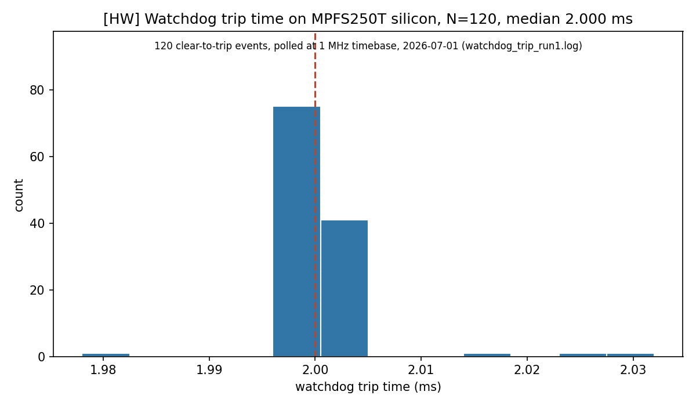

# PolarFire Hybrid Control

Hybrid PID + neural-network control on a commercial PolarFire SoC Icicle Kit (MPFS250T), using SmartHLS C++ and CoreVectorBlox V250. Part of [Tychon quantum sensing](../../README.md).

**Hardware scope.** The recorded tests used one development kit with replayed input, not a live diamond sensor. An RT PolarFire port and space qualification remain future work; neither is demonstrated here.

## Where this fits

| | |
|---|---|
| Purpose | Run a PID (proportional-integral-derivative) controller with a neural-network correction on a PolarFire SoC Icicle Kit, with a fabric watchdog whose timeout triggers a software-mediated fallback to plain PID. Processor software starts the fabric controller updates, so a frozen processor prevents fallback until it resumes |
| Takes in | The INT8 TFLite model from [`odmr-edge-ml`](../odmr-edge-ml/README.md), compiled here for the CoreVectorBlox V250 neural-network engine, and replayed rows taken from held-out synthetic test spectra ([firmware notes](firmware/linux/README.md)) |
| Produces | The Libero FPGA design and SmartHLS PID, kit software in `firmware/`, and dated measurement reports in `docs/` and `libero/reports/` |
| Status | Measured on one kit: watchdog trip time (2026-07-01), an 8-hour soak (2026-07-02) and fallback to plain PID (2026-10-09), listed in What This Does below. The loop is paced by software on the SoC's processor, not in the fabric. Its input is replayed, with no live diamond sensor. The vector tracker is not in this loop |
| Try it without a kit | `python3 tools/rung_g_replay.py --dry-run --out /tmp/rung_g_dry` writes replay telemetry from a software model, or run the [demo dashboard](../../demo/fpga-demo-dashboard/README.md) in dry-run mode. Building needs Libero SoC, SmartHLS and the VectorBlox SDK on an x86 host; running needs the kit |

## What This Does

- SmartHLS C++ PID controller with AI-to-PID handover. The October 9 board test observed no output jump in its 60 ordinary handovers; recovery and limiting cases retain discontinuities ([test report](docs/watchdog_fallback_test_plan.md)).
- An AI sector clamp with a hardcoded outer fraction of 0.045, a configurable inner bound, and slew limiting. The amplitude bound is 4.5% of the full actuator range, not 4.5% of its positive endpoint ([source](hls/src/safety_clamps.cpp), [constants](hls/include/rta_config.hpp)).
- Fabric watchdog detection with processor-dependent fallback to pure PID; the recorded demo image has a verified 2 ms watchdog — trip time **measured on silicon 2026-07-01: median 2.000 ms over 120 trips** (`docs/watchdog_trip_measured_2026-07-01.md`). Fallback at the actuator **measured on silicon 2026-10-09** (`docs/watchdog_fallback_test_plan.md`, sections Results and Fix 1a): when the next controller update sees the timeout, control passes to plain PID within one update (66–71 µs) with no jump in the actuator value, 60/60; after a software fix that starts the hand-over whenever the timeout is high, short-timeout cases fell back 20/20 times (previously 0/20). After a 1 s control-process pause, all ten cases were PID-only after resume: nine forced recoveries and one already PID-only before the pause. This is not ten observed transitions. A processor that stays frozen gets no fallback until it resumes, and at recovery the actuator still steps by about 0.01, ten times the slew limit
- Kit-resident **MSS-paced closed loop measured on silicon 2026-07-02**: the on-kit V250→PID daemon sustains **~3.3 kHz standalone** (proven laptop-disconnected, from distinct hardware `axi_write_count` + software step counters), and passed an **8-hour daytime soak: 95.7 M steps at 3319 Hz, zero stalls, 5 transient >2 ms scheduling stalls, each counted as a trip by the 2 ms fabric watchdog, memory flat** (a counted trip does not show that the controller fell back; the fallback measurement is the item above) (`docs/mss_paced_loop_measured_2026-07-02.md`) — the loop is MSS software (not fabric-resident) with a replayed input (not a live sensor)
- Libero SoC project targeting MPFS250T with CoreVectorBlox V250
- Static timing (SmartTime) and power estimation (SmartPower)

## Architecture

```
+-------------------------------------------------------------+
|                    MPFS250T Fabric                           |
|                                                             |
|  MSS (RISC-V)                                               |
|  +-- FIC0 fabric address space                              |
|  |   +-- 0x60030000 --> CoreVectorBlox V250 control UIO     |
|  |   +-- 0x60040000 --> idfix2 two-slot PID M0/M1 window    |
|  |       +-- M0 0x60040000..0x600407ff gains/start          |
|  |       +-- M1 0x60040800..0x60040fff pid_csr/readback     |
|  |                                                          |
|  +-- FIC2 AXI4 target --> MSS DDR non-cached path           |
|  |                         (V250 model / IO DMA buffers)    |
|                                                             |
|  PID fabric domain --> 125 MHz; V250 core path --> 200 MHz  |
|  PF_INIT_MONITOR_0 --> Reset sequencing                     |
+-------------------------------------------------------------+
```

Current hardware bring-up uses the Linux/Yocto userspace path on the U54 cores:
`generic-uio` exposes the V250 control page, and `/dev/udmabuf-ddr-nc0`
provides non-cached DDR buffers for the V250 data path. The PID calculation and clamps execute in fabric. Processor software starts each controller update and handles the trip-start correction. Linux scheduling therefore affects update timing and fallback; the recorded loop is not autonomous in fabric.

## Directory Structure

```
polarfire-hybrid-control/
+-- hls/                    SmartHLS C++ source
|   +-- src/                PID controller, safety clamps, watchdog
|   +-- include/            Fixed-point types, RTA configuration
|   +-- tb/                 Testbenches and stimulus data
+-- libero/                 Libero SoC project
|   +-- scripts/            Tcl automation (scaffold -> synth -> P&R)
|   +-- constraints/        Timing (SDC) and pin (PDC) constraints
|   +-- reports/            Synthesis and timing reports
+-- firmware/               RISC-V Linux userspace helpers for V250/PID bring-up and demo control
+-- models/                 Compiled .vnnx model artifacts (not committed)
+-- docs/                   Safety architecture documentation
```

## Build

SmartHLS and Libero require an x86 host with Microchip tools installed.

```
make hls-test   # Run SmartHLS C++ software testbench
make clean       # Remove all build artifacts
make help        # Show available targets
```

Libero Tcl scripts must be sourced in order from the Libero Tcl console. If the Libero project does not yet exist on your build machine, re-source all four scripts sequentially to create it from scratch:

```
source libero/scripts/01_scaffold_proj.tcl
source libero/scripts/02_import_ip.tcl
source libero/scripts/03_smartdesign.tcl
source libero/scripts/04_synth_pnr.tcl
```

## Key Constraints

- SmartHLS type: `hls::ap_fixpt<W,I>` (NOT `ap_fixed` -- that's Xilinx)
- VectorBlox SDK **v2.0.3** (NOT v3.0) -- matches CoreVectorBlox IP v2.0.1
- `.vnnx` compiled with `-c V250` flag; not committed to git
- Linux/Yocto on the U54 cores runs the CoreVectorBlox Icicle runtime and starts fabric PID updates. The <150 us loop-latency figure is a design budget. RTL simulation records 6 cycles = 48 ns from start acceptance to actuator write, constant over 128 iterations ([report](docs/fabric_latency_sim_2026-07-01.md)). This excludes processor scheduling and inference. [On-kit API measurements](docs/latency_measured_2026-06-21.md) are separate; direct silicon measurement inside the fabric remains open.

## Current Hardware State



*Measured on hardware [HW]: 120 clear-to-trip events on the dev kit on 2026-07-01, from `libero/reports/2026-07-01-watchdog-trip/watchdog_trip_run1.log`.*

**Recorded state, not a live inventory.** Later measurements are listed in [What This Does](#what-this-does). The source clamp repair described below has not been established as part of the programmed image.

### Historical bring-up snapshots: June 2026

The following dated observations preserve the build history. They do not relax the dashboard's M0-read prohibition or establish the kit's present power or image state.

The June 21 dashboard remediation pass was recorded in:
`docs/remediation_status_2026-06-21.md` and `docs/remediation_progress_2026-06-21.md`.
The remaining-work execution plan is `docs/everything_else_execution_plan_2026-06-21.md`.
The dashboard LIVE path is idfix2-aware and guarded: enable it only with
`KIT_BITSTREAM=idfix2 ALLOW_IDFIX2_M0=1`; M0 reads remain blocked; M0 writes are allowlisted to
limits/gains/start; actuator values are read from M1 `R_POST_CLAMP`. A bounded smoke through
`tools/rung_g_replay.py --host icicle --rows 5 --out /tmp/idfix2_smoke --plot` produced nonzero
M1 actuator values and advancing `axi_write_count`. V250 still probes successfully
(`out[0]=-2.9506`, `error_val=0`, `csr_version=0x00010000`).

Evidence captured in this pass:

- `docs/latency_measured_2026-06-21.md` — on-kit V250/PID helper bounds plus host-paced rung-G
  timing. Linux userspace traps `rdcycle`, so pure V250/fabric cycle timing is still pending.
- `libero/reports/2026-06-21-idfix2-resource/` — idfix2 resource bundle; device/package source is
  MPFS250T FCVG484 from the compile report. **Package-label note for all committed reports:**
  Synplify mapper outputs (`*_fpga_mapper*.rpt`, `*.srr`) print Synplify's internal device-DB
  name `mpfs250tfcg1152std`, which maps every MPFS250T package onto one mapper part — it is not
  the board package. The Libero project targets `FCVG484` (`libero/scripts/01_scaffold_proj.tcl`),
  every Libero-proper report says `Package: FCVG484`, and die resources are identical across
  MPFS250T packages, so utilization percentages are unaffected.
- `libero/reports/2026-06-21-scan/` — read-only FlashPro scan-chain evidence; no programming action.
- `libero/reports/2026-06-21-latency/` — raw on-kit `vnnx_latency` and `pid_latency` logs.
- `libero/reports/2026-06-21-safety-build/` — cloned 1 ms watchdog safety-build attempt. The clone
  was patched to `WATCHDOG_TIMEOUT_CYCLES=125000`, but Libero/Synplify hung before exporting a `.job`;
  no programming action. Forward-looking demo acceptance has been relaxed to a verified 2 ms
  watchdog target (`WATCHDOG_TIMEOUT_CYCLES=250000` at 125 MHz); see
  `docs/credible_demo_finish_criteria_2026-06-21.md`.
- `libero/reports/2026-06-21-watchdog-2ms/` — exported and programmed
  `WATCHDOG_TIMEOUT_CYCLES=250000` two-slot image. Timing met, FlashPro scan passed, PROGRAM passed,
  rollback command/hash recorded, V250 probe passed, dashboard guarded stream passed, and the kit-side
  V250 loop clears the watchdog until stopped.
- `libero/reports/2026-06-21-workload-power-topname/` — SmartPower explicit-VCD-top rerun attempt.
  The run produced a default-equivalent report with no annotation evidence; no workload-annotated
  SmartPower report was produced.
- `docs/nn_sector_certificate_plan_2026-06-21.md` and
  `docs/real_nv_dataset_hunt_2026-06-21.md` — research-track status, both partial.

Persistent programming was performed only for the dated 2 ms watchdog image after rollback hashes,
the exact rollback command, and FlashPro scan visibility were recorded. Post-program checks confirmed
CSR access, V250 inference, guarded actuator telemetry, and watchdog clear/trip behavior. A physical
cold power-cycle remains a recommended operator check, but was not needed for the captured V250
post-program probe.

Measured bounds recorded on 2026-06-21: V250 `vbx_cnn_model_start`+poll via `vnnx_latency` has
median `32 us` and p99 `33 us` for the already-loaded model path; idfix2 M0 start pulse plus M1
`post_clamp_out` read via `pid_latency` has median `4 us` and p99 `4 us`; the host-paced
`tools/rung_g_replay.py --rows 120` loop has median inter-sample period `10122 us`.
Added 2026-07-01: fabric watchdog clear→trip time via `watchdog_trip` is median `2.000 ms`,
min `1.978` / max `2.032 ms` over 120 trips (tails bounded by observer poll jitter) — equal to
the 250,000-cycle @ 125 MHz design value; evidence `libero/reports/2026-07-01-watchdog-trip/`.

The 2026-06-16 report records the CoreVectorBlox **2.0.1/V250** rebuild programmed and
**V250 inference completing on MPFS250T silicon** (`vbx_probe` →
INFERENCE COMPLETED, `vnnx_smoke` → `out[0]=-2.9506`; VERSION `0x60030028`=`0x20000000`).
See `docs/rung_f_v250_on_silicon_results_2026-06-16.md`, `docs/track0_bringup_runbook.md`,
and `docs/fpga_reproducibility_inventory_2026-06-16.md`.

**The 2026-06-18 report records three functioning `idfix2` paths on MPFS250T silicon** (job `39c8bcf2…`, timing met +0.789 ns):
- **V250 inference** — `vbx_probe` INFERENCE COMPLETED, `vnnx_smoke` `out[0]=-2.9506` (a cold
  power-cycle is required after any fabric program for V250 init).
- **Clean M0/M1 CSR plane** — gains slave (M0 `0x60040000`) and `pid_csr` (M1 `0x60040800`) both
  read/write bit-exact, no wedge.
- **LIVE PID actuator** — set gains via M0, inject error via M1 (`0x810/0x814`), pulse start
  (`0x60040008`), read the latched actuator (`0x60040844`): it tracks `error` at Kp and the sector
  clamp saturates (err 2.0 → +1.0). `tools/rung_g_replay.py --host icicle` streams the ODMR trace
  through it; `tools/rung_g_animate.py` renders the moving dashboard.

Two latent RTL bugs were fixed to get here (verified in ModelSim *and* on silicon): the M0
`nv_pid_top.reset` tie-off + demux 9→1-bit ID truncation (bus wedge), and the un-latched 1-cycle
actuator output. Engineering log: `docs/two_slot_handoff_2026-06-17.md` (2026-06-18 sections) +
`docs/two_slot_demo_scope_2026-06-18.md`. Rollbacks: idfix `7907a83f`, demo `a5550f9e`, V250 `4e3323e8`.

Hardware blockers recorded during this bring-up:

- **Fabric PCIe @ `0x3000000000` is broken in the 2.0.1/V250 rebuild** — the Linux
  `microchip-pcie` probe hangs on it (the V250/FIC path is fine). This *was* a boot-loop; it is now
  **persistently worked around** — the PCIe device-tree node is disabled at boot via a reversible
  U-Boot env `fdt set`, so a normal reboot recovers autonomously to an inference-ready kit (see
  `docs/rung_f_v250_on_silicon_results_2026-06-16.md` §6 and `/root/PCIE-DISABLED-README.md` on the kit).
  The only remaining work is the *optional* long-term fix (re-synth with the fabric PCIe intact) **if
  PCIe is ever needed**. The trusted rung-A seed_7 (1.1.12/V500) `.job` remains the bitstream rollback.
- **`0x60001000` is the DMA controller, not the PID — never poke it.** On the two-slot bitstream
  the PID lives on SLAVE3 `0x60040000`: the **M1 `pid_csr` (`0x60040800`) is clean and validated**,
  the **M0 AXI-completion defect that wedged a U54 was FIXED 2026-06-18 (`idfix2`)** — M0 now
  reads/writes cleanly and the live PID actuator works. (Historical: on the older `idfix`/demo/
  seed_7 bitstreams an M0 read wedged the kit — never run M0 accesses against those.)
  See `docs/two_slot_demo_scope_2026-06-18.md`.

## Safety Architecture

The safeguards remain in the source. They do not establish autonomous fail-safe operation or a complete stability proof.

1. **AI amplitude bound.** The hardcoded outer fraction is 0.045 of `out_max - out_min`. The configurable inner bound cannot exceed it. This actuator bound differs from the ±2.25 µT training and host-evaluation clip ([integration contract](../odmr-edge-ml/docs/scalar_target_repair_integration_contract_2026-10.md)).
2. **Slew and final saturation.** The AI correction's change is limited to 0.001 per controller invocation. The PID sum is then saturated to the configured actuator limits. This is not a guarantee that every handover or recovery step respects the AI slew limit.
3. **Watchdog detection and handover.** The recorded image detects a missed heartbeat after 250,000 fabric cycles, or 2 ms at 125 MHz. Processor software must start a controller update for the PID-only output to appear. A permanently frozen processor receives no recovery output.

**Source repair, not verified image deployment.** The October 9 [clamp repair](https://github.com/jasonphillip/tychon-quantum-sensing/commit/541e3e7f4266cb17776f5a41733af417ea1f163e) applies the amplitude bound again after slew limiting. It handles a tightened bound immediately, even when the stored correction exceeds it. The commit and [safety analysis](docs/safety_architecture.md) record a C++ testbench check and an open synthesis check. A programmed-image deployment of this repair is not established by the published evidence.

**Recorded recovery limits.** The separate [firmware trip-start correction](docs/watchdog_fallback_test_plan.md) closed the observed short-timeout hole: 20/20 short-stall cases fell back. All ten paused-process cases were PID-only after resume: nine through forced recovery and one already PID-only before the pause. Recovery medians of 0.010–0.013, with maxima up to 0.065, remained above the 0.001 slew limit. Eleven of 104 forced starts showed discontinuities in limiting or repeated-trip cases ([engineering decision](../../docs/engineering-decisions.md#2-test-actual-fallback-rather-than-count-watchdog-trips)).

The AI path is **sector-bounded by design within the documented design assumptions**. Plant identification, sampled-data and delay analysis, trained-network bounds, and other [proof obligations](docs/safety_architecture.md) remain open. Neither the clamp nor the observed handovers establish safety for an attached physical plant.

## Power Analysis

SmartPower synthesis reports are generated on the Beelink build host and archived outside this repository. The numbers below are **default-toggle estimates** (activity-factor heuristic, no VCD): preliminary until workload-driven SmartPower is run with a representative input trace.

| Component | Power (SmartPower, two-slot r12_s31 netlist, 2026-07-01) |
|-----------|-------|
| FPGA fabric — PID-workload-annotated (1.28% pins; V250/MSS vectorless) | **2,550.0 mW** (Static 445.842 / Dynamic 2104.200) |
| FPGA fabric — pure vectorless baseline, same netlist | 2,562.2 mW (Static 445.842 / Dynamic 2116.373) |
| Total system (MPFS250T + DDR + I/O) | ~5.2 W (fabric + MSS estimate) |
| **SWaP budget** | **12 W** |
| **Margin** | **~57%** (preliminary — PID-subsystem-annotated only; full-design workload SmartPower (RPO-6) and board measurement still open) |

Provenance note: earlier README revisions cited 2,664 mW (an acceptance
target in an unexecuted plan) and then 2,622.9 mW — the latter turns out to
be the 2026-06-21 rerun against the Microchip REFERENCE-design project, not
this design. The 2026-07-01 numbers above are the first SmartPower results
from the actual seed7 two-slot project; see
`libero/reports/2026-07-01-workload-power-subsystem/README.md`.

Static power is derived from SmartPower estimation. The `smartpower_report.rpt` artifact is not committed to this repo — it is regenerated on each synthesis run via `libero/scripts/04_synth_pnr.tcl`. Workload-driven SmartPower is one of the Residual Proof Obligations (closable under follow-on path) in `docs/safety_architecture.md`.

2026-06-21 update: the SmartPower workload flow was patched to import the VCD with explicit top
`nv_pid_top_top`; the rerun produced Total `2622.855 mW`, Static `445.612 mW`, Dynamic
`2177.243 mW`, matching the previous default/vectorless result. No annotation log/result was
produced, so the report is still vectorless/default activity rather than workload-driven.
